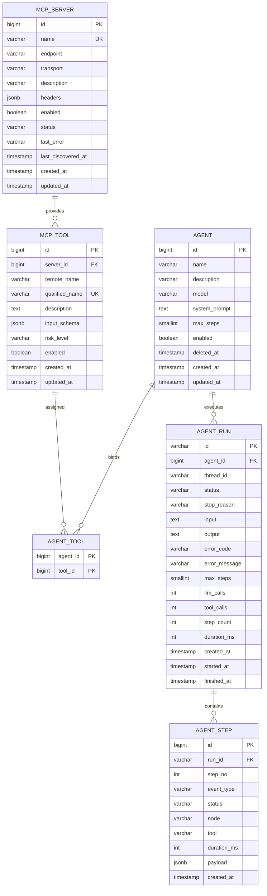

# AgentHub 数据库设计文档

> **项目名称：AgentHub**
> **文档类型：数据库详细设计（Database Design）**
> **版本：V1.0 MVP · DB Design v1.2（对齐 Contract v1.3）**
> **上游文档：AgentHub_系统设计文档.md（§10）、AgentHub_接口契约文档.md**
> **日期：2026 年 9 月**
> **目标数据库：PostgreSQL 16**

---

## 0. 文档说明

### 0.1 本文档解决什么

系统设计文档给出了 ER 图，接口契约文档给出了字段级 DTO，但两者之间的**落库细节**尚未定义：字段类型与长度、约束、索引、级联规则、JSONB 结构、迁移策略。本文档补齐这一层，是 D（Platform & Data）的实现依据，也是 A/B 理解 `TraceSink` 行为与 C 理解列表接口性能的前提。

### 0.2 三份文档的分工

| 文档 | 层次 | 回答的问题 |
|---|---|---|
| 系统设计文档 | 架构 | 有哪些模块、如何交互 |
| 接口契约文档 | 协议 | 传什么字段、什么类型、什么枚举 |
| **本文档** | 存储 | 怎么落库、怎么约束、怎么查得快 |

### 0.3 范围内 / 范围外

**范围内**：6 张表的逻辑与物理设计、完整 DDL、索引、JSONB 结构、Alembic 迁移、事务与超时约定、DTO↔列映射。

**范围外**：不涉及 Redis / 消息队列 / 向量库 / 分区表 / 物化视图 / 全文检索（依据设计文档 §2.2 约束）；不做多租户与复杂 RBAC。

---

## 1. 设计约定

| 项 | 约定 |
|---|---|
| 表名 | 单数 `snake_case`（`agent`、`mcp_server`、`agent_step`） |
| 列名 | `snake_case`，全小写 |
| 主键 | 默认 `bigint GENERATED BY DEFAULT AS IDENTITY`；`agent_run` 用业务字符串主键 |
| 外键命名 | `fk_<表>_<列>` |
| 唯一约束 | `uq_<表>_<列...>` |
| 检查约束 | `ck_<表>_<语义>` |
| 索引 | `idx_<表>_<列...>` |
| 字符集 / 排序 | UTF8 / `en_US.UTF-8`（无需 locale 相关排序） |
| 时间 | 全部 `timestamptz`，**统一存 UTC**，展示层按 `Asia/Shanghai` 换算 |
| 枚举 | `varchar` + `CHECK` 约束，**不使用 PostgreSQL ENUM 类型**（理由见 §9 D-DB1） |
| 布尔 | `boolean NOT NULL DEFAULT`，禁止 nullable 布尔 |
| 金额/计数 | `integer`（本系统无金额） |
| 软删除 | 仅 `agent` 使用 `deleted_at`；其余资源用 `enabled` 置位（见 §9 D-DB4） |
| `updated_at` | 由应用层 `onupdate=func.now()` 维护，**不建触发器**（见 §9 D-DB5） |
| JSONB 使用 | 仅用于 schema 与 trace payload，禁止把可查询的业务字段塞进 JSONB |
| 大小写敏感 | 全部标识符小写，不加引号即可使用 |

### 1.1 命名约定在 SQLAlchemy 中的落地

Alembic autogenerate 的约束名依赖 `naming_convention`，必须在 `MetaData` 上全局声明，否则迁移脚本会生成随机名、无法回滚：

```python
from sqlalchemy import MetaData

NAMING_CONVENTION = {
    "ix": "idx_%(table_name)s_%(column_0_N_name)s",
    "uq": "uq_%(table_name)s_%(column_0_N_name)s",
    "ck": "ck_%(table_name)s_%(constraint_name)s",
    "fk": "fk_%(table_name)s_%(column_0_name)s",
    "pk": "pk_%(table_name)s",
}

metadata = MetaData(naming_convention=NAMING_CONVENTION)
```

---

## 2. 逻辑模型



### 2.1 实体数量级估算

| 表 | 量级（课程演示） | 主要增长来源 |
|---|---:|---|
| `agent` | 十级 | 手工创建 |
| `mcp_server` | 个位数 | 手工注册 |
| `mcp_tool` | 十级 | Discovery |
| `agent_tool` | 十级 | 绑定操作 |
| `agent_run` | 百~千级 | 每次 Playground 运行 |
| `agent_step` | 万级 | 每 Run 约 10~15 行 |

**结论**：全部为小表，不需要分区、归档与只读副本；索引按访问路径精确建即可。

---

## 3. 表详细设计

### 3.1 `agent` —— Agent 配置

| 列 | 类型 | NULL | 默认 | 说明 |
|---|---|:--:|---|---|
| `id` | bigint | 否 | identity | 主键 |
| `name` | varchar(64) | 否 | — | Agent 名称，**不做唯一约束**（见 §9 D-DB2） |
| `description` | varchar(512) | 是 | NULL | 描述 |
| `model` | varchar(128) | 否 | — | `provider/model` 形式，如 `deepseek/deepseek-chat` |
| `system_prompt` | text | 否 | `''` | 上限 8000 字符由应用层保证 |
| `max_steps` | smallint | 否 | `8` | 1 ~ 20（DB 与 DTO 双重校验） |
| `enabled` | boolean | 否 | `true` | 禁用后不允许发起 Run |
| `deleted_at` | timestamptz | 是 | NULL | 软删除标记（契约 §4.1.5） |
| `created_at` | timestamptz | 否 | `now()` | — |
| `updated_at` | timestamptz | 否 | `now()` | 应用层维护 |

**约束**

| 名称 | 类型 | 定义 |
|---|---|---|
| `pk_agent` | PK | `(id)` |
| `ck_agent_max_steps` | CHECK | `max_steps BETWEEN 1 AND 20` |

**索引**

| 名称 | 列 | 类型 | 服务的查询 |
|---|---|---|---|
| `idx_agent_created_at_active` | `(created_at DESC) WHERE deleted_at IS NULL` | 部分索引 | §4.1.2 Agent 列表（默认按 `-created_at` 排序、过滤软删除） |

**设计说明**

- 列表接口的 `enabled` 过滤与 `keyword` 模糊匹配不建索引：数据量为十级，顺序扫描更快，避免无效索引。
- `deleted_at` 用部分索引而非复合索引，因为软删除过滤是恒定条件。

### 3.2 `mcp_server` —— MCP Server 配置

| 列 | 类型 | NULL | 默认 | 说明 |
|---|---|:--:|---|---|
| `id` | bigint | 否 | identity | 主键 |
| `name` | varchar(64) | 否 | — | 唯一；即 `server_slug` 的来源 |
| `endpoint` | varchar(512) | 否 | — | Streamable HTTP 地址 |
| `transport` | varchar(32) | 否 | `'streamable_http'` | 见契约 §2.6 |
| `description` | varchar(512) | 是 | NULL | 描述 |
| `headers` | jsonb | 是 | NULL | **敏感**：仅后端读取，任何接口都不回传（契约 §3.2） |
| `enabled` | boolean | 否 | `true` | — |
| `status` | varchar(16) | 否 | `'UNKNOWN'` | 连通性状态，见契约 §2.5 |
| `last_error` | varchar(512) | 是 | NULL | 最近一次失败原因（已脱敏、已截断） |
| `last_discovered_at` | timestamptz | 是 | NULL | 最近一次 Discovery 成功时间 |
| `created_at` | timestamptz | 否 | `now()` | — |
| `updated_at` | timestamptz | 否 | `now()` | 应用层维护 |

**约束**

| 名称 | 类型 | 定义 |
|---|---|---|
| `pk_mcp_server` | PK | `(id)` |
| `uq_mcp_server_name` | UNIQUE | `(name)` → 冲突返回 `409 CONFLICT` |
| `ck_mcp_server_transport` | CHECK | `transport IN ('streamable_http','stdio')` |
| `ck_mcp_server_status` | CHECK | `status IN ('UNKNOWN','CONNECTED','ERROR')` |

**索引**：除 PK / UNIQUE 外无额外索引（个位数行数，列表全扫）。

**设计说明**

- **`server_slug` 不入库**。它由 `name` 按契约 §3.2 规则实时推导，避免入库值与规则变更后不一致；`qualified_name` 已固化在 `mcp_tool` 中，改 `name` 会与已有 `qualified_name` 冲突——因此**约定：Server 注册后 `name` 不允许修改**（`McpServerUpdate` 中 `name` 字段实际不生效，见 §9 D-DB6）。
- **`tool_count` 不入库**。契约 `McpServerRead.tool_count` 由查询时 `COUNT(mcp_tool.id)` 聚合得到，避免 Discovery 与计数写入不一致。
- `headers` V1 **明文存储**（决策 D-DB9）：依赖"不返回前端 + 不落 Trace + 不打印日志"三重约束保障，不引入密钥管理。

### 3.3 `mcp_tool` —— Tool 元数据

| 列 | 类型 | NULL | 默认 | 说明 |
|---|---|:--:|---|---|
| `id` | bigint | 否 | identity | 主键 |
| `server_id` | bigint | 否 | — | FK → `mcp_server.id` |
| `remote_name` | varchar(128) | 否 | — | MCP 原始 tool 名 |
| `qualified_name` | varchar(200) | 否 | — | `server_slug.remote_name`，全局唯一 |
| `description` | text | 否 | `''` | 来自 MCP `tools/list` |
| `input_schema` | jsonb | 否 | `'{}'` | **JSON Schema 原文**，不做改写 |
| `risk_level` | varchar(16) | 否 | `'LOW_RISK'` | 按契约 §3.3 规则推断，可人工覆盖 |
| `enabled` | boolean | 否 | `true` | Discovery 中消失的 Tool 置 `false` |
| `created_at` | timestamptz | 否 | `now()` | — |
| `updated_at` | timestamptz | 否 | `now()` | 应用层维护 |

**约束**

| 名称 | 类型 | 定义 |
|---|---|---|
| `pk_mcp_tool` | PK | `(id)` |
| `fk_mcp_tool_server_id` | FK | `(server_id) → mcp_server(id) ON DELETE CASCADE` |
| `uq_mcp_tool_server_id_remote_name` | UNIQUE | `(server_id, remote_name)` → Discovery upsert 的冲突键 |
| `uq_mcp_tool_qualified_name` | UNIQUE | `(qualified_name)` → 契约要求全局唯一 |
| `ck_mcp_tool_risk_level` | CHECK | `risk_level IN ('READ_ONLY','LOW_RISK','WRITE','HIGH_RISK')` |

**索引**

| 名称 | 列 | 服务的查询 |
|---|---|---|
| `idx_mcp_tool_server_enabled` | `(server_id, enabled)` | §4.2.6 按 Server 过滤可用 Tool；ToolSelector 取候选集 |

**设计说明**

- **字段长度与超长处理**：`remote_name` 上限 128。Discovery 时若 MCP 返回超过 128 字符的名称，**跳过该 Tool 并记 warning**，不阻断同 Server 其他 Tool 入库（`qualified_name` 上限 200 已足够容纳 64 + 1 + 128）。
- **`HIGH_RISK` 不入库**：Discovery 识别为 `HIGH_RISK` 的 Tool 直接丢弃（契约 §2.4"V1 不接入"），因此 `ck_mcp_tool_risk_level` 虽允许该值，实际数据中不应出现；保留枚举值是为将来放开时无需改约束。
- **upsert 语义**：Discovery 以 `(server_id, remote_name)` 为冲突键执行 `INSERT ... ON CONFLICT DO UPDATE`，更新 `description` / `input_schema` / `updated_at`；本次未返回的 Tool 置 `enabled=false`（不物理删除，保留历史绑定关系可解释性）。

### 3.4 `agent_tool` —— Agent 与 Tool 绑定

| 列 | 类型 | NULL | 说明 |
|---|---|:--:|---|
| `agent_id` | bigint | 否 | FK → `agent.id` |
| `tool_id` | bigint | 否 | FK → `mcp_tool.id` |

**约束**

| 名称 | 类型 | 定义 |
|---|---|---|
| `pk_agent_tool` | PK | `(agent_id, tool_id)` → 天然防重 |
| `fk_agent_tool_agent_id` | FK | `(agent_id) → agent(id) ON DELETE CASCADE` |
| `fk_agent_tool_tool_id` | FK | `(tool_id) → mcp_tool(id) ON DELETE CASCADE` |

**索引**

| 名称 | 列 | 服务的查询 |
|---|---|---|
| `idx_agent_tool_tool_id` | `(tool_id)` | 反查"哪些 Agent 绑定了该 Tool"；同时支撑 FK 级联删除 |

**设计说明**

- 不加 `created_at`：绑定关系无时序查询需求（V1 不展示"绑定时间"）。
- `PUT /api/agents/{id}/tools` 为全量覆盖：实现为单事务内 `DELETE WHERE agent_id=?` + `INSERT` 差集，短事务、行数极小，无需增量 diff 优化。

### 3.5 `agent_run` —— 一次运行记录

| 列 | 类型 | NULL | 默认 | 说明 |
|---|---|:--:|---|---|
| `id` | varchar(32) | 否 | — | 主键，`r_` + 12 位小写十六进制 |
| `agent_id` | bigint | 否 | — | FK → `agent.id` |
| `thread_id` | varchar(32) | 否 | — | `t_` + 12 位小写十六进制；V1 每 Run 新建、不复用（契约 D4） |
| `status` | varchar(16) | 否 | `'PENDING'` | 见契约 §2.1 |
| `stop_reason` | varchar(16) | 是 | NULL | 见契约 §2.2；未结束时为 NULL |
| `input` | text | 否 | — | 用户输入，上限 8000 字符由应用层保证 |
| `output` | text | 是 | NULL | 最终答案 |
| `error_code` | varchar(32) | 是 | NULL | 复用契约 §1.5 错误码 |
| `error_message` | varchar(512) | 是 | NULL | 已脱敏、已截断 |
| `max_steps` | smallint | 否 | — | **本次 Run 实际生效的 max_steps 快照**（见下） |
| `llm_calls` | integer | 否 | `0` | LLM 调用次数 |
| `tool_calls` | integer | 否 | `0` | Tool 调用次数 |
| `step_count` | integer | 否 | `0` | LangGraph 图执行步数（见 §4） |
| `duration_ms` | integer | 是 | NULL | 总耗时 |
| `created_at` | timestamptz | 否 | `now()` | 记录创建 |
| `started_at` | timestamptz | 是 | NULL | 开始执行 |
| `finished_at` | timestamptz | 是 | NULL | 结束 |

**约束**

| 名称 | 类型 | 定义 |
|---|---|---|
| `pk_agent_run` | PK | `(id)` |
| `fk_agent_run_agent_id` | FK | `(agent_id) → agent(id) ON DELETE RESTRICT` |
| `ck_agent_run_status` | CHECK | `status IN ('PENDING','RUNNING','SUCCESS','PARTIAL','FAILED','CANCELLED')` |
| `ck_agent_run_stop_reason` | CHECK | `stop_reason IS NULL OR stop_reason IN ('FINISHED','MAX_STEPS','MODEL_ERROR','TOOL_ERROR','INTERNAL_ERROR','CANCELLED')` |
| `ck_agent_run_max_steps` | CHECK | `max_steps BETWEEN 1 AND 20` |

**索引**

| 名称 | 列 | 服务的查询 |
|---|---|---|
| `idx_agent_run_agent_id_created_at` | `(agent_id, created_at DESC)` | §4.3.5 Agent 历史 Run 列表（默认倒序） |
| `idx_agent_run_status_created_at` | `(status, created_at DESC)` | 按状态筛选 Run；进程重启后捞取滞留的 `RUNNING` Run |

**设计说明**

- **为什么要存 `max_steps` 快照**：契约 D1 允许 Run 级覆盖 `max_steps`，若不入库，事后无法还原这次 Run 到底被允许跑多少步，`MAX_STEPS` 的判定就不可复现。
- **FK 用 `RESTRICT` 而非 `CASCADE`**：Agent 只做软删除，正常情况下不会触发；若有人试图物理删除有历史 Run 的 Agent，`RESTRICT` 会拦下来，保护运行记录这一"审计资产"。
- **`step_count` 与 `agent_step` 的关系**：`step_count = MAX(agent_step.step_no)`，但它在 Run 结束时**冗余写入**——因为 Run 摘要接口（§4.3.2）会被频繁调用，不应每次都聚合 step 表。

### 3.6 `agent_step` —— Trace / 执行步骤

| 列 | 类型 | NULL | 默认 | 说明 |
|---|---|:--:|---|---|
| `id` | bigint | 否 | identity | 主键，**同时作为 SSE 的 `id`**（`Last-Event-ID` 语义） |
| `run_id` | varchar(32) | 否 | — | FK → `agent_run.id` |
| `step_no` | integer | 否 | — | 逻辑步序号，见 §4 |
| `event_type` | varchar(32) | 否 | — | 契约 §2.7 的 UPPER_SNAKE 值 |
| `status` | varchar(16) | 否 | — | 契约 §2.3 |
| `node` | varchar(32) | 是 | NULL | `model_node` / `tools_node` / NULL（Run 级事件） |
| `tool` | varchar(200) | 是 | NULL | `qualified_name`，仅 Tool 相关事件 |
| `duration_ms` | integer | 是 | NULL | 该事件耗时 |
| `payload` | jsonb | 否 | `'{}'` | 事件明细，结构见 §5 |
| `created_at` | timestamptz | 否 | `now()` | — |

**约束**

| 名称 | 类型 | 定义 |
|---|---|---|
| `pk_agent_step` | PK | `(id)` |
| `fk_agent_step_run_id` | FK | `(run_id) → agent_run(id) ON DELETE CASCADE` |
| `ck_agent_step_event_type` | CHECK | 9 种取值，见契约 §2.7 |
| `ck_agent_step_status` | CHECK | `status IN ('RUNNING','SUCCESS','FAILED','SKIPPED')` |
| `ck_agent_step_node` | CHECK | `node IS NULL OR node IN ('model_node','tools_node')` |
| `ck_agent_step_step_no` | CHECK | `step_no >= 0` |

**索引**

| 名称 | 列 | 服务的查询 |
|---|---|---|
| `idx_agent_step_run_step_no` | `(run_id, step_no, id)` | §4.3.3 历史 Trace（`after_step_no` 增量补齐、按 `step_no, id` 排序） |
| `idx_agent_step_run_id_id` | `(run_id, id)` | SSE 断线重连（`WHERE run_id=? AND id > ?`，契约 §5.2 规则 4） |

**关键设计说明**

- **`(run_id, step_no)` 绝不可加 UNIQUE 约束**。同一个 `step_no` 会产生多条事件（例如 `LLM_STARTED` 与 `LLM_FINISHED` 共享同一 `step_no`，见契约 §5.4 示例），事件的唯一性由自增 `id` 保证，`step_no` 只用于分组与排序。
- **不建 `payload` 的 GIN 索引**：V1 没有按 payload 内容检索的需求，GIN 索引会显著放大写入成本，得不偿失。
- **不给 `payload` 加体积 CHECK**：契约 §7 规定超过 64 KB 由应用层裁剪；若用 DB 约束拦截，一旦 Trace 写入异常会直接报错，违背"Trace 降级不阻断 Runtime"的原则。

---

## 4. `step_no` / `step_count` / `max_steps` 语义（冻结）

这三个概念横跨 Runtime（A）、Trace（D）与 UI（C），必须唯一定义，否则时间线渲染与停止判定会打架。

### 4.1 定义

| 概念 | 定义 |
|---|---|
| `step_no = 0` | **Run 级事件**：`RUN_STARTED`、`TOOL_CANDIDATES`。不对应任何图节点 |
| `step_no = N (N ≥ 1)` | **第 N 个 LangGraph 图执行步**（super-step）。一次节点执行 = 一步 |
| 同一 `step_no` 内 | 该步产生的全部事件共享同一个 `step_no`（如 `LLM_STARTED` + `LLM_FINISHED`；`TOOL_CALL_STARTED` + `TOOL_CALL_FINISHED`） |
| 事件内排序 | 同一 `step_no` 内按 `id ASC` 排列 |
| `RUN_FINISHED` / `RUN_FAILED` | `step_no = step_count`（与最后一步同号，靠更大的 `id` 排在最后） |
| `step_count` | Run 内出现过的最大 `step_no`，即**图节点执行总次数** |
| `max_steps` | 允许的最大图执行步数；`step_count >= max_steps` 触发 `MAX_STEPS`（设计文档 §6.4） |

> 该定义与 LangGraph checkpointer 的 `step` 计数同源，因此 A 侧的 `step_count` 可直接取图状态值，无需自行维护计数器。

### 4.2 与契约 §5.4 示例的一致性

契约示例中：`RUN_STARTED(0)` → `TOOL_CANDIDATES(1)` → `LLM_STARTED/LLM_FINISHED(1)` → `TOOL_CALL_STARTED/TOOL_CALL_FINISHED(2)` → … → `RUN_FINISHED(5)`，`step_count=5`、`llm_calls=3`、`tool_calls=2`（3 次 model 节点 + 2 次 tools 节点 = 5 步）。**完全自洽，契约无需修改。**

---

## 5. JSONB 结构契约

### 5.1 `mcp_tool.input_schema`

直接存储 MCP `tools/list` 返回的 `inputSchema` **原文**，不做字段改名、不裁剪、不补默认值。

```json
{
  "type": "object",
  "properties": {
    "state": { "type": "string", "enum": ["open", "closed"] },
    "per_page": { "type": "integer", "minimum": 1, "maximum": 100 }
  },
  "required": ["state"]
}
```

约定：
- 必须是合法 JSON Schema（`type: object`）；若 MCP 返回非法结构，Discovery 时记为 warning 并以 `{}` 入库、`enabled=false`。
- Tool Router 的入参校验以本字段为准（契约 §6.1），因此**不得**在入库时改写。

### 5.2 `agent_step.payload`

`payload` 的内容即契约 §5.3 中各事件 `data` 字段的对象，按 `event_type` 一一对应：

| `event_type` | `payload` 键 |
|---|---|
| `RUN_STARTED` | `agent_id`, `input`, `max_steps`, `model` |
| `LLM_STARTED` | `model`, `message_count`, `candidate_tools` |
| `LLM_FINISHED` | `model`, `token_usage`, `finish_reason`, `tool_call_count`, `error` |
| `TOOL_CANDIDATES` | `names`, `scores`, `strategy`, `top_k` |
| `TOOL_CALL_STARTED` | `arguments` |
| `TOOL_CALL_FINISHED` | `result_summary`, `truncated`, `result_bytes`, `error` |
| `STATE_UPDATED` | `step_count`, `final_answer` |
| `RUN_FINISHED` | `output`, `stop_reason`, `llm_calls`, `tool_calls`, `step_count` |
| `RUN_FAILED` | `stop_reason`, `error_code`, `error_message`, `partial_output` |

**注意**：`run_id` / `step_no` / `event_type` / `status` / `node` / `tool` / `duration_ms` / `timestamp` 已提升为独立列，**payload 中不得重复存储**。`timestamp` 落在 `created_at`。

### 5.3 落库前的脱敏与裁剪（应用层，与契约 §7 一致）

| 规则 | 实现位置 |
|---|---|
| 键名匹配 `token` / `secret` / `password` / `passwd` / `api_key` / `apikey` / `authorization` / `cookie`（忽略大小写，递归） | `TraceMapper` |
| `result_summary` / `error_message` / `last_error` 截断至 2000 字符（`error_message`、`last_error` 受列长限制再截断至 512） | `TraceMapper` / Service |
| `payload` 序列化后 > 64 KB → 丢弃 `content` 数组，仅保留 `text` 与 `error` | `TraceMapper` |
| Tool Result 原始 `content` 不入库；`headers` 明文仅存 `mcp_server.headers` | `McpToolGateway` |
| **应用日志禁止打印 `headers` / API Key 原值**，出参统一 `***` | 全局日志配置 / Service |

> 最后一行是 §5.3 中唯一不在 `TraceMapper` 内的规则：它约束的是**日志输出**而非落库。`logger.info(f"register server {payload}")` 这类写法会把 Key 写进日志文件，必须由 Service 层显式脱敏后再打印（见 §7.6）。

---

## 6. 完整 DDL

> 与 Alembic 初始迁移 `0001_initial_schema` 一一对应。可直接在 psql 中执行以核对模型。

```sql
-- =============================================================
-- AgentHub V1.0 MVP — Initial Schema (PostgreSQL 16)
-- =============================================================

-- ---------- agent ----------
CREATE TABLE agent (
    id            bigint      GENERATED BY DEFAULT AS IDENTITY,
    name          varchar(64)  NOT NULL,
    description   varchar(512),
    model         varchar(128) NOT NULL,
    system_prompt text         NOT NULL DEFAULT '',
    max_steps     smallint     NOT NULL DEFAULT 8,
    enabled       boolean      NOT NULL DEFAULT true,
    deleted_at    timestamptz,
    created_at    timestamptz  NOT NULL DEFAULT now(),
    updated_at    timestamptz  NOT NULL DEFAULT now(),
    CONSTRAINT pk_agent PRIMARY KEY (id),
    CONSTRAINT ck_agent_max_steps CHECK (max_steps BETWEEN 1 AND 20)
);
CREATE INDEX idx_agent_created_at_active
    ON agent (created_at DESC) WHERE deleted_at IS NULL;

COMMENT ON TABLE agent IS 'Agent 持久化配置（AgentDefinition）';


-- ---------- mcp_server ----------
CREATE TABLE mcp_server (
    id                 bigint       GENERATED BY DEFAULT AS IDENTITY,
    name               varchar(64)  NOT NULL,
    endpoint           varchar(512) NOT NULL,
    transport          varchar(32)  NOT NULL DEFAULT 'streamable_http',
    description        varchar(512),
    headers            jsonb,
    enabled            boolean      NOT NULL DEFAULT true,
    status             varchar(16)  NOT NULL DEFAULT 'UNKNOWN',
    last_error         varchar(512),
    last_discovered_at timestamptz,
    created_at         timestamptz  NOT NULL DEFAULT now(),
    updated_at         timestamptz  NOT NULL DEFAULT now(),
    CONSTRAINT pk_mcp_server PRIMARY KEY (id),
    CONSTRAINT uq_mcp_server_name UNIQUE (name),
    CONSTRAINT ck_mcp_server_transport
        CHECK (transport IN ('streamable_http', 'stdio')),
    CONSTRAINT ck_mcp_server_status
        CHECK (status IN ('UNKNOWN', 'CONNECTED', 'ERROR'))
);

COMMENT ON TABLE mcp_server IS 'MCP Server 注册信息';
COMMENT ON COLUMN mcp_server.headers IS '敏感字段，仅后端读取，任何接口不回传';


-- ---------- mcp_tool ----------
CREATE TABLE mcp_tool (
    id             bigint       GENERATED BY DEFAULT AS IDENTITY,
    server_id      bigint       NOT NULL,
    remote_name    varchar(128) NOT NULL,
    qualified_name varchar(200) NOT NULL,
    description    text         NOT NULL DEFAULT '',
    input_schema   jsonb        NOT NULL DEFAULT '{}'::jsonb,
    risk_level     varchar(16)  NOT NULL DEFAULT 'LOW_RISK',
    enabled        boolean      NOT NULL DEFAULT true,
    created_at     timestamptz  NOT NULL DEFAULT now(),
    updated_at     timestamptz  NOT NULL DEFAULT now(),
    CONSTRAINT pk_mcp_tool PRIMARY KEY (id),
    CONSTRAINT fk_mcp_tool_server_id
        FOREIGN KEY (server_id) REFERENCES mcp_server (id) ON DELETE CASCADE,
    CONSTRAINT uq_mcp_tool_server_id_remote_name UNIQUE (server_id, remote_name),
    CONSTRAINT uq_mcp_tool_qualified_name UNIQUE (qualified_name),
    CONSTRAINT ck_mcp_tool_risk_level
        CHECK (risk_level IN ('READ_ONLY', 'LOW_RISK', 'WRITE', 'HIGH_RISK'))
);
CREATE INDEX idx_mcp_tool_server_enabled ON mcp_tool (server_id, enabled);

COMMENT ON TABLE mcp_tool IS 'MCP Tool 元数据（Tool Registry 的存储层）';


-- ---------- agent_tool ----------
CREATE TABLE agent_tool (
    agent_id bigint NOT NULL,
    tool_id  bigint NOT NULL,
    CONSTRAINT pk_agent_tool PRIMARY KEY (agent_id, tool_id),
    CONSTRAINT fk_agent_tool_agent_id
        FOREIGN KEY (agent_id) REFERENCES agent (id) ON DELETE CASCADE,
    CONSTRAINT fk_agent_tool_tool_id
        FOREIGN KEY (tool_id) REFERENCES mcp_tool (id) ON DELETE CASCADE
);
CREATE INDEX idx_agent_tool_tool_id ON agent_tool (tool_id);

COMMENT ON TABLE agent_tool IS 'Agent 与 Tool 的多对多绑定关系';


-- ---------- agent_run ----------
CREATE TABLE agent_run (
    id            varchar(32) NOT NULL,
    agent_id      bigint      NOT NULL,
    thread_id     varchar(32) NOT NULL,
    status        varchar(16) NOT NULL DEFAULT 'PENDING',
    stop_reason   varchar(16),
    input         text        NOT NULL,
    output        text,
    error_code    varchar(32),
    error_message varchar(512),
    max_steps     smallint    NOT NULL,
    llm_calls     integer     NOT NULL DEFAULT 0,
    tool_calls    integer     NOT NULL DEFAULT 0,
    step_count    integer     NOT NULL DEFAULT 0,
    duration_ms   integer,
    created_at    timestamptz NOT NULL DEFAULT now(),
    started_at    timestamptz,
    finished_at   timestamptz,
    CONSTRAINT pk_agent_run PRIMARY KEY (id),
    CONSTRAINT fk_agent_run_agent_id
        FOREIGN KEY (agent_id) REFERENCES agent (id) ON DELETE RESTRICT,
    CONSTRAINT ck_agent_run_status
        CHECK (status IN ('PENDING', 'RUNNING', 'SUCCESS', 'PARTIAL', 'FAILED', 'CANCELLED')),
    CONSTRAINT ck_agent_run_stop_reason
        CHECK (stop_reason IS NULL OR stop_reason IN
               ('FINISHED', 'MAX_STEPS', 'MODEL_ERROR', 'TOOL_ERROR',
                'INTERNAL_ERROR', 'CANCELLED')),
    CONSTRAINT ck_agent_run_max_steps CHECK (max_steps BETWEEN 1 AND 20)
);
CREATE INDEX idx_agent_run_agent_id_created_at
    ON agent_run (agent_id, created_at DESC);
CREATE INDEX idx_agent_run_status_created_at
    ON agent_run (status, created_at DESC);

COMMENT ON TABLE agent_run IS '一次 Agent 运行记录';
COMMENT ON COLUMN agent_run.max_steps IS '本次 Run 实际生效的 max_steps 快照，用于复现';


-- ---------- agent_step ----------
CREATE TABLE agent_step (
    id          bigint      GENERATED BY DEFAULT AS IDENTITY,
    run_id      varchar(32) NOT NULL,
    step_no     integer     NOT NULL,
    event_type  varchar(32) NOT NULL,
    status      varchar(16) NOT NULL,
    node        varchar(32),
    tool        varchar(200),
    duration_ms integer,
    payload     jsonb       NOT NULL DEFAULT '{}'::jsonb,
    created_at  timestamptz NOT NULL DEFAULT now(),
    CONSTRAINT pk_agent_step PRIMARY KEY (id),
    CONSTRAINT fk_agent_step_run_id
        FOREIGN KEY (run_id) REFERENCES agent_run (id) ON DELETE CASCADE,
    CONSTRAINT ck_agent_step_event_type CHECK (event_type IN (
        'RUN_STARTED', 'LLM_STARTED', 'LLM_FINISHED', 'TOOL_CANDIDATES',
        'TOOL_CALL_STARTED', 'TOOL_CALL_FINISHED', 'STATE_UPDATED',
        'RUN_FINISHED', 'RUN_FAILED'
    )),
    CONSTRAINT ck_agent_step_status
        CHECK (status IN ('RUNNING', 'SUCCESS', 'FAILED', 'SKIPPED')),
    CONSTRAINT ck_agent_step_node
        CHECK (node IS NULL OR node IN ('model_node', 'tools_node')),
    CONSTRAINT ck_agent_step_step_no CHECK (step_no >= 0)
);
CREATE INDEX idx_agent_step_run_step_no ON agent_step (run_id, step_no, id);
CREATE INDEX idx_agent_step_run_id_id   ON agent_step (run_id, id);

COMMENT ON TABLE agent_step IS 'Trace / 执行步骤；id 同时作为 SSE 的事件 id';
COMMENT ON COLUMN agent_step.step_no
    IS '图执行步序号；0 为 Run 级事件；同一 step_no 可有多条事件，不做唯一约束';
```

---

## 7. 迁移与数据访问约定

### 7.1 Alembic 迁移策略

| 项 | 约定 |
|---|---|
| 目录 | `agenthub/alembic/versions/`（与设计文档 §15 代码结构一致） |
| 文件命名 | `YYYYMMDD_HHMM_<slug>.py`，如 `20260910_2130_initial_schema.py` |
| revision 说明 | 单行英文，动词开头：`create agent_step table` |
| 生成方式 | 改 SQLAlchemy 模型 → `alembic revision --autogenerate -m "..."` → **人工审查** → 提交 |
| 必须人工检查 | 部分索引、`CHECK` 约束、`jsonb` 默认值、`server_default`、列类型变更 |
| 执行时机 | 容器启动入口执行 `alembic upgrade head`；本地为显式手动执行 |
| downgrade | 初始迁移与后续迁移都必须实现 `downgrade()`，至少保证可回退一步 |
| 禁止 | 手工在数据库执行 DDL 后不写迁移；`alembic stamp` 跳过未执行的迁移 |

### 7.2 预期迁移序列（V1）

| 版本 | 内容 |
|---|---|
| `0001_initial_schema` | 本文档 §6 全部 6 张表与索引 |
| `0002_seed_none` | 预留（V1 无种子数据） |

### 7.3 连接与超时

```python
# 引擎级：默认语句超时 15s，含 pool_pre_ping
create_async_engine(
    settings.database_url,                      # postgresql+asyncpg://...
    pool_size=10,
    max_overflow=20,
    pool_pre_ping=True,
    pool_recycle=1800,
    connect_args={"server_settings": {
        "statement_timeout": "15000",
        "idle_in_transaction_session_timeout": "30000",
        "application_name": "agenthub",
    }},
)
```

| 操作 | 语句超时 | 依据 |
|---|---:|---|
| Trace / Step 写入 | **3s**（session 内 `SET LOCAL statement_timeout='3s'`） | 设计文档 §14.1：DB 写 Step 2~3s，超时则降级不阻断 Runtime |
| 其余 CRUD / Run 查询 | 15s（引擎默认） | — |
| `alembic upgrade` | 无限制（迁移连接单独创建） | — |

### 7.4 事务边界（冻结）

| 场景 | 事务范围 | 要求 |
|---|---|---|
| 创建 Run | `INSERT agent_run`（`status=RUNNING`、`started_at=now()`）+ `INSERT agent_step(RUN_STARTED)` | 单事务提交后才返回 `202` |
| Trace 写入 | **每条事件一个独立短事务** | 禁止把整个 Run 包进一个长事务；失败只记日志，不抛异常（契约 §6.3） |
| Run 结束 | `UPDATE agent_run`（`status` / `stop_reason` / `output` / `error_*` / counters / `duration_ms` / `finished_at`）+ `INSERT agent_step(RUN_FINISHED \| RUN_FAILED)` | 单事务；必须提交成功 |
| 更新 Agent / 绑定 Tool | 单事务 | 绑定为 `DELETE` + `INSERT` 差集 |
| Discovery | 单事务内完成全部 Tool 的 upsert 与置 `enabled=false`；`mcp_server` 的 `status` / `last_error` / `last_discovered_at` 同事务更新 | 保证 Server 状态与 Tool 集合一致 |

**并发保护**：`agent_run` 状态更新的 `UPDATE` 语句必须带前置状态条件（`WHERE id=? AND status IN ('PENDING','RUNNING')`），防止重复结束或取消与正常结束竞争。

### 7.5 Repository 层约定

- 所有 DB 访问经 `app/repositories/`，**不允许**在 API 层或 Runtime 层直接持有 `AsyncSession`（契约 §6.4）。
- 返回值为契约定义的 DTO（`AgentRead` / `RunRead` / `StepRead`），不向上层泄漏 ORM 实体。
- `tool_ids`（`AgentRead`）与 `tool_count`（`McpServerRead`）为**聚合字段**，由 Repository 组装，对应表结构中无同名列：

| DTO 字段 | 来源 |
|---|---|
| `AgentRead.tool_ids` | `SELECT tool_id FROM agent_tool WHERE agent_id=?` |
| `McpServerRead.tool_count` | `SELECT COUNT(*) FROM mcp_tool WHERE server_id=?` |
| `RunRead.step_count` | `agent_run.step_count`（冗余列，见 §3.5） |
| `StepRead.payload` | `agent_step.payload` |

### 7.6 变更操作日志（替代审计表，对应 D-DB10）

| 项 | 约定 |
|---|---|
| 触发时机 | 所有写接口（`POST` / `PUT` / `DELETE`）成功提交后 |
| 日志级别 | `INFO` |
| 固定字段 | `request_id`、`action`（如 `agent.update`、`mcp_server.register`）、`resource`、`resource_id`、`timestamp` |
| 禁止字段 | `headers`、API Key、`system_prompt` 原文 |
| 落库 | **不落库**，仅标准输出，由容器日志采集 |
| 不记录 | 读接口（`GET` / SSE）不记，避免日志淹没 |

---

## 8. 数据生命周期（对应契约 D3）

| 项 | V1 策略 |
|---|---|
| 自动清理 | **不做**。不引入定时任务（避免基础设施膨胀，设计文档 §2.2） |
| 保留期限 | 全量保留；`agent_run` + `agent_step` 是演示与答辩的核心资产 |
| 手动清理 | 需要时执行下面 SQL（不提供 API）： |
| 容量 | 1000 Run ≈ 1.2 万行 `agent_step` ≈ 25 MB，无压力 |

```sql
-- 手动清理：删除 N 天前的 Run（级联删除 agent_step）
DELETE FROM agent_run WHERE created_at < now() - interval '30 days';
```

| 删除动作 | 级联结果 |
|---|---|
| 软删除 Agent | 无级联；Run / Step 全量保留，历史可查 |
| 删除 MCP Server | `mcp_tool` 级联删除 → `agent_tool` 级联删除；绑定关系静默丢失（V1 可接受，前端刷新后可见） |
| 删除 Run | `agent_step` 级联删除 |
| Tool 从 Server 消失 | 仅置 `enabled=false`，绑定关系保留 |

---

## 9. 设计决策记录

| 编号 | 决策 | 理由 |
|---|---|---|
| D-DB1 | 枚举用 `varchar` + `CHECK`，不用 PG `ENUM` | PG ENUM 增删值需 `ALTER TYPE`，且 Alembic autogenerate 支持差；`CHECK` 改起来只是删建约束。代价是约束与业务枚举需人工同步，由本文档与契约 §2 保证一致 |
| D-DB2 | `agent.name` **不加唯一约束** | 允许重名（用 `id` 区分）可避免"软删除 + 唯一约束"的交互复杂度（软删后同名能否重建），且课程场景无重名冲突风险。`mcp_server.name` 因参与 `qualified_name` 生成，必须唯一 |
| D-DB3 | `(run_id, step_no)` **不唯一** | 同一 `step_no` 天然存在多条事件；唯一性由自增 `id` 承担 |
| D-DB4 | 软删除仅用于 `agent` | Run 是审计资产，Agent 删除后仍要可查历史；`mcp_server` / `mcp_tool` 用 `enabled` 表达"停用"，避免出现"软删除但仍被绑定"的歧义 |
| D-DB5 | 不建 `updated_at` 触发器 | 单写入方（同一后端进程），应用层 `onupdate` 足够；少一个函数、少一次迁移负担 |
| D-DB6 | `mcp_server.name` 注册后不可修改 | 它派生出 `server_slug`，进而影响 `mcp_tool.qualified_name`；改名会导致已绑定的 `qualified_name` 失效 |
| D-DB7 | `server_slug` / `tool_count` 不落库 | 二者均可由现有列推导，入库只会带来一致性问题 |
| D-DB8 | 不分区、不建物化视图、不建 GIN 索引 | 数据量为万级，索引收益为负（写入放大）；避免过度设计 |

---

## 10. 已确认决策（原待确认项）

> 2026-09-10 小组确认，纳入 DB Design v1.1。

| 编号 | 问题 | 决策 | 落点 |
|---|---|---|---|
| D-DB9 | `mcp_server.headers` 是否加密存储 | **明文存储，不引入密钥管理**；`headers` 字段保留 | §3.2、§5.3 |
| D-DB10 | 是否需要操作审计（谁在何时改了 Agent / 注册了 Server） | **不做审计表**；改为写接口的结构化日志 | §7.6 |

### 10.1 决策依据

**D-DB9 —— 加密在此环境下收益接近于零。**

- 密钥只能来自环境变量或配置文件，与密文同机同库；能读到数据库的攻击者同样能读到容器环境变量，威胁模型不成立。
- 引入 `AGENTHUB_SECRET_KEY` 意味着"密钥丢失 = 全部 MCP Server 不可用"与密钥轮换需全表重加密，这些都会在演示当天变成真实风险。
- 已具备三重防线：不返回前端（契约 §3.2）、不落 Trace（契约 §7）、不打印日志（§5.3）。
- `headers` **字段必须保留**：接 GitHub MCP 这类需要 PAT 的真实 Server 时是必需的，删掉会让平台只能连无鉴权的玩具服务。
- 例外：若课程评分标准明确要求"敏感信息加密存储"，改应用层 AES-GCM（`core/crypto.py` + 一个环境变量），成本可控。

**D-DB10 —— 没有身份就没有审计。**

- 契约 §1.1 明确 V1 无登录、无 `Authorization` 头，"谁"这一维度不存在，审计只能记 IP 或写死 `system`，做出来是假的。
- 审计与权限天然一体：有了"谁改了 Agent"，下一个问题必然是"谁有权改 Agent"，而设计文档 §1.3 已明确不做复杂 RBAC，范围会扩散。
- 时间维度已由 `created_at` / `updated_at` 覆盖。
- **不预留 `created_by` / `updated_by` 空列**：无身份来源，空列纯属噪声；将来真有登录体系时，加列是向后兼容操作。

---

## 11. 版本记录

| 版本 | 日期 | 变更 | 对齐 |
|---|---|---|---|
| DB Design v1.0 | 2026-09-10 | 首次成文：6 张表字段/约束/索引、完整 DDL、JSONB 结构、`step_no` 语义冻结、迁移与事务约定、8 项设计决策 | Contract v1.1 |
| DB Design v1.1 | 2026-09-10 | 确认原 §10 两项待确认项（D-DB9 `headers` 明文存储、D-DB10 不做审计改用结构化日志）；§5.3 补充"日志禁止打印 `headers`"规则；新增 §7.6 变更操作日志约定 | Contract v1.2 |
| DB Design v1.2 | 2026-09-10 | 同步契约 v1.3：`agent_run.stop_reason` 的 CHECK 与 DDL 新增 `INTERNAL_ERROR`（§3.5、§6） | Contract v1.3 |
