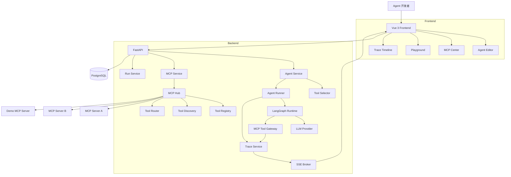
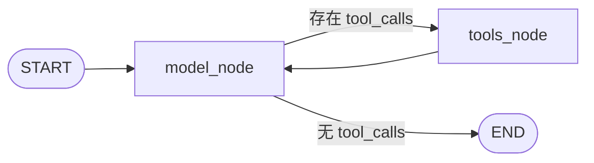
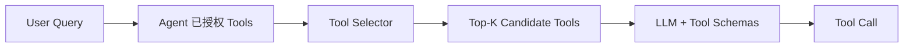
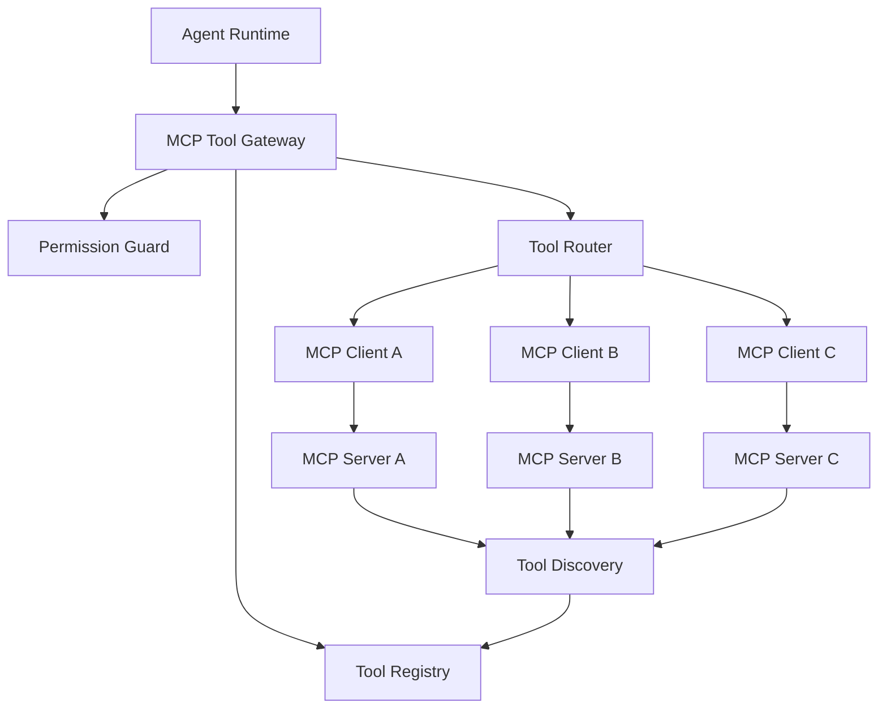
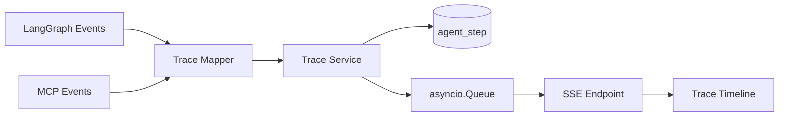
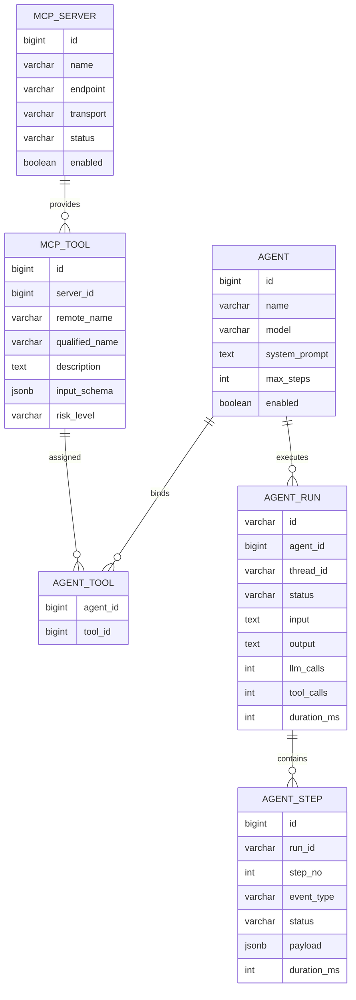
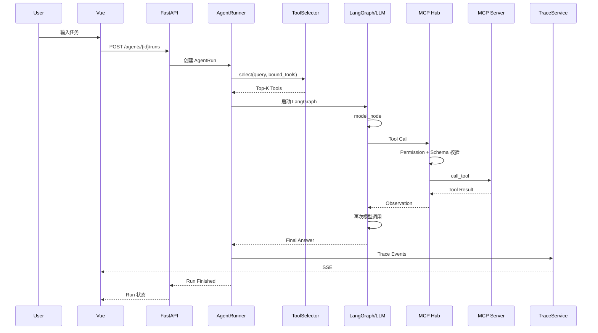

# AgentHub 系统设计文档

> **项目名称：AgentHub**  
> **项目类型：开源软件实践课程设计 / Agent 开发者工具**  
> **版本：V1.0 MVP**  
> **技术栈：Python 3.12+ / FastAPI / LangGraph / MCP Python SDK / Vue 3 / PostgreSQL**  
> **日期：2026 年 9 月**

---

## 1. 项目概述

AgentHub 是一个**面向 Agent 开发者的轻量级 MCP Agent 构建、运行与调试平台**。

项目不追求复刻 Dify、Flowise 等完整 AI 应用开发平台，而是聚焦以下最小闭环：

**创建 Agent → 接入 MCP 工具 → 运行 Agent → 观察执行过程 → 调试问题**

### 1.1 核心用户故事

开发者可以创建一个 Agent，为其配置：

- 大语言模型
- System Prompt
- 最大执行步数
- 可用 MCP 工具

随后在 Playground 中输入任务，平台自动执行 Agent，并实时展示：

- LLM 调用
- 动态工具候选
- Tool Calling
- MCP Tool 执行
- Observation 回填
- Agent 状态变化
- 最终回答
- 运行耗时与状态

### 1.2 本期范围

V1.0 包括：

- Agent 配置管理
- LangGraph Agent Runtime
- MCP Hub
- MCP Tool Discovery
- Tool Registry
- 动态 Tool Selection
- Execution Trace
- SSE 实时推送
- Agent Run History
- PostgreSQL 持久化

### 1.3 明确不做

为控制课程开发量，V1.0 不实现：

- DAG Workflow
- RAG 知识库
- Multi-Agent
- 长期 Memory
- Browser Agent
- Coding Agent
- 复杂 RBAC
- 多租户
- 计费系统
- 插件市场

---

## 2. 设计目标与约束

### 2.1 设计目标

AgentHub 的目标是提供一个轻量、可观察、可扩展的 Agent 开发与调试平台。

核心目标包括：

1. 通过 LangGraph 管理 Agent 状态与执行循环；
2. 通过 MCP 统一连接外部工具；
3. 通过 Tool Registry 解耦 Agent 与具体 MCP Server；
4. 支持动态 Tool Selection，降低无关 Tool Schema 注入；
5. 通过 Execution Trace 观察 Agent 每一步行为；
6. 使用 SSE 将运行状态实时推送至前端；
7. 保持整体架构简单，确保课程周期内可以完成。

### 2.2 核心约束

| 约束 | 设计决策 |
|---|---|
| 开发周期有限 | 三周完成主体，第 4 周仅收尾 |
| 不重复造 Agent 框架 | LangGraph 负责 State、Node、Edge、Loop、Streaming |
| 避免基础设施膨胀 | V1 不引入 Redis、消息队列、向量数据库 |
| MCP 版本变化快 | 通过官方 MCP Python SDK 封装协议细节 |
| 调试体验优先 | 所有 Runtime/MCP 事件统一映射为 TraceEvent |
| 单实例优先 | V1 backend 只运行单副本 |

---

## 3. 技术选型

| 层次 | 技术 | 用途 |
|---|---|---|
| 后端 | Python 3.12+ / FastAPI | 异步 API、Pydantic、SSE |
| Agent 编排 | LangGraph | 有状态 Agent Runtime、循环、Streaming |
| LLM 接入 | LangChain ChatModel / OpenAI-compatible | 兼容 DeepSeek、Qwen 等模型 |
| MCP | MCP Python SDK | MCP Client / Server |
| ORM | SQLAlchemy 2.x | 异步数据访问 |
| 数据库迁移 | Alembic | Schema 管理 |
| 数据库 | PostgreSQL | Agent、Tool、Run、Step 持久化 |
| 前端 | Vue 3 + TypeScript | Agent Editor、MCP Center、Playground |
| 实时通信 | SSE | Trace 实时推送 |
| Python 包管理 | uv | 环境与锁文件 |
| 部署 | Docker Compose | 统一部署 |

### 3.1 设计原则

- 不重复实现 LangGraph 已经提供的图执行能力；
- LLM 和 MCP 均视为不可靠外部服务；
- MCP Tool 与 Agent 通过 Registry 解耦；
- Tool 使用 `qualified_name` 解决跨 Server 重名；
- Runtime 不直接依赖 FastAPI Response；
- Trace 事件与业务实体分离；
- 先实现单 Agent + Tool Calling，再做动态工具筛选。

---

## 4. 总体架构



### 4.1 模块职责

| 模块 | 主要职责 | 负责人 |
|---|---|---|
| Agent Runtime | AgentState、LangGraph 执行、模型调用、max_steps、停止策略 | A |
| MCP Hub | Server 注册、Tool Discovery、Registry、Router、风险级别 | B |
| Frontend & Trace UI | Agent Editor、MCP Center、Playground、Trace | C |
| Platform Backend | FastAPI CRUD、数据库、Run/Step、Docker、测试 | D |

---

## 5. 核心领域模型

| 对象 | 关键字段 | 说明 |
|---|---|---|
| AgentDefinition | id, name, model, system_prompt, max_steps, tool_ids | Agent 持久化配置 |
| McpServer | id, name, endpoint, transport, enabled, status | MCP Server 配置 |
| ToolDefinition | qualified_name, description, input_schema, server_id, risk_level | MCP Tool 元数据 |
| AgentState | messages, candidate_tools, step_count, run_id, final_answer | 单次 LangGraph Run 状态 |
| AgentRun | agent_id, thread_id, status, input, output, counters, timestamps | 一次运行记录 |
| TraceEvent | type, run_id, step_no, node, tool, payload, duration, status | 统一 Trace 事件 |

### 5.1 状态边界

- `AgentDefinition`：持久化配置；
- `AgentState`：单次执行过程中的运行态；
- `LangGraph Checkpoint`：图状态快照；
- `AgentRun / AgentStep`：平台业务运行记录。

V1 不实现跨 Agent 的长期记忆。

---

## 6. Agent Runtime 设计

### 6.1 LangGraph 执行模型

V1 使用两个核心节点：

- `model_node`
- `tools_node`



### 6.2 AgentState

```python
class AgentState(TypedDict):
    messages: Annotated[list[BaseMessage], add_messages]
    candidate_tools: list[ToolDefinition]
    step_count: int
    run_id: str
    final_answer: str | None
```

### 6.3 AgentRunner 职责

AgentRunner 负责：

1. 加载 AgentDefinition；
2. 获取 Agent 已绑定工具；
3. 调用 ToolSelector 得到 Top-K 候选工具；
4. 构建或获取 compiled LangGraph；
5. 创建 run_id / thread_id；
6. 使用异步 streaming 执行；
7. 将 LangGraph 事件映射为 TraceEvent；
8. 在成功、超限、模型错误、工具错误时统一结束 Run。

### 6.4 停止条件

| StopReason | 触发条件 | 处理 |
|---|---|---|
| FINISHED | 模型返回最终消息且无 tool_calls | Run=SUCCESS |
| MAX_STEPS | step_count >= max_steps | Run=FAILED/PARTIAL |
| MODEL_ERROR | 模型超时、鉴权、配额、解析错误 | 记录 LLM_ERROR |
| TOOL_ERROR | MCP 工具失败且策略不继续 | 记录 TOOL_ERROR |
| INTERNAL_ERROR | Runtime 内部异常（未归类的代码/依赖错误） | Run=FAILED，记录堆栈 |
| CANCELLED | 客户端取消（P2） | 释放运行状态 |

### 6.5 Checkpoint 策略

V1 主要服务单次 Playground 调试：

- Run / Step 必须落 PostgreSQL；
- LangGraph Checkpointer 第一版使用内存实现；
- 若后续需要中断恢复、多轮 Thread，再升级 PostgreSQL Checkpointer；
- 业务运行记录与 LangGraph Checkpoint 分离。

---

## 7. 动态 Tool Selection

动态工具选择属于 P1 创新功能。

目标是：当一个 Agent 绑定多个 MCP Server、工具数量较多时，不把全部 Tool Schema 一次性注入模型，而是在每次 Run 开始前筛选 Top-K 候选工具。

### 7.1 执行流程



### 7.2 V1 策略

| 阶段 | V1 | 后续 |
|---|---|---|
| 索引文本 | qualified_name + description + server_name | tags / examples |
| 检索算法 | TF-IDF + cosine | Embedding / Reranker |
| 候选范围 | Agent 已绑定且 enabled | 增加场景/风险过滤 |
| Top-K | 默认 5 | 根据上下文预算动态调整 |

### 7.3 接口

```python
class ToolCandidate(BaseModel):
    tool: ToolDefinition
    score: float


class ToolSelector(Protocol):
    async def select(
        self,
        query: str,
        tools: list[ToolDefinition],
        top_k: int = 5,
    ) -> list[ToolCandidate]:
        ...
```

V1 实现：

```text
TfidfToolSelector
```

未来可扩展：

```text
EmbeddingToolSelector
RerankToolSelector
```

### 7.4 为什么不使用向量数据库

本项目不是 RAG 系统。

V1 预计 Tool 数量为几十级，使用进程内 TF-IDF 即可展示动态 Tool Selection 的核心思想，同时减少：

- 部署成本
- 调试成本
- 数据同步复杂度

---

## 8. MCP Hub 设计



### 8.1 Server Registry 与 Discovery

新增 MCP Server 后：

1. 检查 Server 连通性；
2. 调用 MCP Client；
3. 获取 Tool List；
4. 标准化 Tool 元数据；
5. 写入 Tool Registry；
6. Discovery 失败时仅标记当前 Server 为 ERROR。

Tool 命名规范：

```text
qualified_name = server_slug + "." + remote_tool_name
```

示例：

```text
github.list_issues
github.get_file
search.search_web
```

### 8.2 Transport 策略

MVP 优先支持：

```text
Streamable HTTP
```

P2 再考虑：

```text
stdio
```

业务层仅依赖：

```text
McpClientAdapter
```

协议与 Transport 由 MCP SDK 负责。

### 8.3 Tool Router

```python
async def execute(call: ToolCall, ctx: ToolContext) -> ToolResult:
    tool = await registry.require(call.qualified_name)

    permission_guard.check(ctx.agent_id, tool)

    schema_validator.validate(
        tool.input_schema,
        call.arguments,
    )

    result = await mcp_client_factory \
        .for_server(tool.server_id) \
        .call_tool(
            tool.remote_name,
            call.arguments,
        )

    return ToolResult.from_mcp(result)
```

### 8.4 Tool 风险级别

| 风险级别 | 示例 | 默认策略 |
|---|---|---|
| READ_ONLY | search / get / list / 只读查询 | 允许 |
| LOW_RISK | 临时对象、无破坏更新 | 显式启用 |
| WRITE | 文件写入、数据库写入 | MVP 默认禁用 |
| HIGH_RISK | Shell、删除、支付等 | V1 不接入 |

---

## 9. Execution Trace 与 SSE

AgentHub 将 LangGraph 与 MCP 的原始事件统一转换为平台自己的 `TraceEvent`。



### 9.1 TraceService

TraceService 同时负责：

1. 异步持久化 AgentStep；
2. 将事件放入 run_id 对应的 asyncio.Queue；
3. SSE Endpoint 消费 Queue；
4. 将事件实时发送至前端。

### 9.2 TraceEvent 类型

| 事件 | 核心字段 |
|---|---|
| RUN_STARTED | run_id, agent_id |
| LLM_STARTED | model |
| LLM_FINISHED | duration, token_usage |
| TOOL_CANDIDATES | names, scores |
| TOOL_CALL_STARTED | tool, arguments |
| TOOL_CALL_FINISHED | tool, result_summary, duration |
| STATE_UPDATED | step_count |
| RUN_FINISHED | output |
| RUN_FAILED | stop_reason |

### 9.3 SSE 示例

```text
event: tool_call_started
id: 16
data: {"run_id":"r_1001","step":2,"tool":"github.list_issues"}

event: tool_call_finished
id: 17
data: {"run_id":"r_1001","status":"SUCCESS","duration_ms":418}
```

### 9.4 SSE 断连策略

- 浏览器断开 SSE 不取消 Agent Run；
- Run 继续执行并持久化；
- 用户重新进入 Run Detail 后先通过 REST 获取历史 Step；
- 若 Run 未结束，再订阅 SSE；
- V1 不支持跨进程事件总线，因此只部署单 backend 实例。

---

## 10. 数据库设计



### 10.1 核心表

| 表名 | 说明 |
|---|---|
| agent | Agent 配置 |
| mcp_server | MCP Server |
| mcp_tool | Tool 元数据 |
| agent_tool | Agent 与 Tool 多对多关系 |
| agent_run | 一次运行记录 |
| agent_step | Trace / 执行步骤 |

### 10.2 数据存储原则

推荐使用 JSONB 保存：

- `mcp_tool.input_schema`
- `agent_step.payload`

对于大体量 Tool Result：

- 不保存完整结果；
- 仅保存必要结构；
- 保存截断后的摘要；
- 对敏感字段进行脱敏。

> 完整的字段类型与长度、`CHECK` 约束、索引、级联删除规则、事务边界与语句超时，见《AgentHub 数据库设计文档》。

---

## 11. API 设计

### 11.1 Agent API

| Method | Path | 说明 |
|---|---|---|
| POST | `/api/agents` | 创建 Agent |
| GET | `/api/agents` | Agent 列表 |
| GET | `/api/agents/{id}` | Agent 详情 |
| PUT | `/api/agents/{id}` | 修改 Agent |
| DELETE | `/api/agents/{id}` | 删除 / 软删除 |
| PUT | `/api/agents/{id}/tools` | 更新 Agent 工具绑定 |

### 11.2 MCP API

| Method | Path | 说明 |
|---|---|---|
| POST | `/api/mcp/servers` | 注册 MCP Server |
| GET | `/api/mcp/servers` | MCP Server 列表 |
| GET | `/api/mcp/servers/{id}` | MCP Server 详情 |
| PUT | `/api/mcp/servers/{id}` | 修改 MCP Server（**不支持改名**） |
| POST | `/api/mcp/servers/{id}/discover` | 重新发现 Tool |
| POST | `/api/mcp/servers/{id}/test` | 连通性测试 |
| GET | `/api/mcp/tools` | 查询 Tool |
| POST | `/api/mcp/tools/{id}/test` | 手动测试 Tool |

> `name` 注册后不可修改：它派生出 `server_slug`，进而决定 `mcp_tool.qualified_name`（详见接口契约文档 D6）。

### 11.3 Run / Trace API

| Method | Path | 说明 |
|---|---|---|
| POST | `/api/agents/{id}/runs` | 创建并启动 Run |
| GET | `/api/runs/{run_id}` | Run 摘要 |
| GET | `/api/runs/{run_id}/steps` | 历史 Trace |
| GET | `/api/runs/{run_id}/events` | SSE 实时事件 |
| GET | `/api/agents/{id}/runs` | Agent 历史 Run |
| POST | `/api/runs/{run_id}/cancel` | 取消 Run（P2；V1 可返回 `501`） |

---

## 12. 前端设计

### 12.1 页面

| 页面 | 功能 | 优先级 |
|---|---|---|
| Agent List | AgentCard、创建 Agent | P0 |
| Agent Editor | 模型、Prompt、Tool、maxSteps | P0 |
| MCP Center | Server、状态、Discovery、Tool Table | P0 |
| Playground | Chat Input、Run、Final Answer、Trace | P0 |
| Run Detail | Step Timeline、Tool 参数、结果、耗时 | P1 |

### 12.2 Playground 推荐布局

```text
┌─────────────────────────────┬─────────────────────────────┐
│           Playground        │       Execution Trace       │
│                             │                             │
│ User Input                  │ Step 1 LLM                 │
│                             │ Step 2 Tool Candidates     │
│ Final Answer                │ Step 3 MCP Tool Call       │
│                             │ Step 4 Observation         │
│                             │ Step 5 Final Answer        │
└─────────────────────────────┴─────────────────────────────┘
```

前端不实现 Vue Flow，不实现可拖拽 DAG。

---

## 13. 关键调用时序



---

## 14. 异常与安全设计

### 14.1 超时策略

| 调用 | 建议超时 | 失败处理 |
|---|---:|---|
| LLM 请求 | 60s | MODEL_ERROR |
| MCP Discover | 10s | 当前 Server=ERROR |
| MCP Tool Call | 20~30s | ToolResult Error |
| DB 写 Step | 2~3s | Trace 降级，不阻断 Runtime |

### 14.2 安全边界

- LLM / MCP API Key 仅保存在后端；
- 不向前端返回敏感 Key；
- MCP Endpoint 进行协议与地址校验；
- 课程环境默认只接可信 MCP Server；
- Tool 参数按 `input_schema` 校验；
- Trace 中对 token/password/secret 字段脱敏；
- Tool Result 设置最大持久化长度；
- V1 不接入 Shell、任意文件写、系统命令等高风险工具。

---

## 15. 项目代码结构

```text
agenthub/
├── app/
│   ├── main.py
│   ├── api/
│   │   ├── agents.py
│   │   ├── mcp.py
│   │   └── runs.py
│   │
│   ├── agent/
│   │   ├── state.py
│   │   ├── graph.py
│   │   ├── runner.py
│   │   ├── model_provider.py
│   │   └── stop_policy.py
│   │
│   ├── tools/
│   │   ├── selector.py
│   │   ├── registry.py
│   │   └── permission.py
│   │
│   ├── mcp/
│   │   ├── client_adapter.py
│   │   ├── discovery.py
│   │   ├── router.py
│   │   └── schemas.py
│   │
│   ├── trace/
│   │   ├── events.py
│   │   ├── mapper.py
│   │   ├── service.py
│   │   └── sse_broker.py
│   │
│   ├── models/
│   ├── repositories/
│   ├── schemas/
│   └── core/
│
├── tests/
├── demo_mcp_server/
├── pyproject.toml
└── docker-compose.yml

frontend/
├── src/views/AgentList.vue
├── src/views/AgentEditor.vue
├── src/views/McpCenter.vue
├── src/views/Playground.vue
└── src/components/TraceTimeline.vue
```

---

## 16. 四人模块分工

| 成员 | 责任域 | 主要交付 | 关键接口 |
|---|---|---|---|
| A | LangGraph Agent Runtime | AgentState、Graph、AgentRunner、ModelProvider、StopPolicy | `AgentRunner.run()` |
| B | MCP Hub & Tool Selection | MCP Client、Discovery、Registry、Router、TF-IDF Selector | `list_tools()` / `execute_tool()` / `select()` |
| C | Vue & Trace UI | Agent Editor、MCP Center、Playground、SSE Timeline | REST DTO / SSE Contract |
| D | FastAPI Platform & Data | CRUD、SQLAlchemy、Run/Step、Alembic、Docker、测试 | Repository / REST API |

### 16.1 协作约定

第 1 天冻结以下公共协议：

- Pydantic DTO
- ToolDefinition
- TraceEvent
- RunStatus
- StopReason
- SSE Event Contract

原则：

- A/B 不直接修改前端；
- C 不依赖后端内部 Python 类；
- D 维护数据库模型与 REST 边界；
- 跨模块通过固定接口联调。

---

## 17. 测试方案

| 测试层 | 工具 / 方式 | 核心用例 |
|---|---|---|
| 单元测试 | pytest / pytest-asyncio | ToolSelector、Router、StopPolicy、Schema Validation |
| MCP 集成 | Demo MCP Server | Discovery、call_tool、错误、超时 |
| Agent 集成 | Mock ChatModel | 无 Tool、单 Tool、多 Tool、max_steps |
| API 测试 | FastAPI TestClient / httpx | CRUD、Run、Steps |
| SSE 测试 | httpx async stream | 事件顺序、断连 |
| 前端验收 | 人工 + 截图 | 创建→绑定→运行→Trace→历史 Run |

### 17.1 核心演示测试

创建一个 Research Agent，并绑定：

- GitHub MCP
- Search MCP

输入一个至少需要两次工具调用的任务。

Trace 必须展示：

- Top-K 候选工具
- Tool Call
- Tool Result 摘要
- LLM Step
- Final Answer
- 总耗时

---

## 18. 部署设计

```text
docker compose
├── backend      # FastAPI + Uvicorn
├── frontend     # Vue build + Nginx
├── postgres     # 平台数据库
└── demo-mcp     # Demo MCP Server（默认启动；不自动注册进平台）

external
├── LLM API
└── Other MCP Servers
```

V1 后端单实例部署。

原因：

```text
SSEBroker -> asyncio.Queue
```

属于进程内状态。

未来多实例时可替换：

- Redis Streams
- Redis Pub/Sub
- Kafka / RabbitMQ 等消息总线

但不属于本课程版本。

---

## 19. 实现顺序与里程碑

| 阶段 | 总目标 | A | B | C | D |
|---|---|---|---|---|---|
| Week 1 | 跑通 Agent→Tool→Observation→Final | LangGraph Loop | 1 个 Demo MCP + Execute | Playground 骨架 | Agent/MCP CRUD + DB |
| Week 2 | 完整产品闭环 | Trace 事件映射 | Discovery + Registry | SSE Trace + MCP Center | Run/Step 持久化 |
| Week 3 | 创新点与质量 | max_steps / 统计 | Top-K Selection + Risk | Tool 候选与耗时 UI | 集成测试 + Docker |
| Week 4 | 只收尾 | Bug | Bug | 答辩 UI | 文档 / 部署 / 验收 |

---

## 20. 扩展点

| 能力 | V1 | 后续 |
|---|---|---|
| 多轮 Memory | 不做 | LangGraph Store / Postgres Checkpointer |
| Human-in-the-loop | 不做 | interrupt + resume |
| Workflow | 不做 | Workflow Builder |
| Multi-Agent | 不做 | Supervisor / Handoff |
| RAG | 不做 | 作为 MCP Tool 接入 |
| Tool Retrieval | TF-IDF Top-K | Embedding + Reranker |
| Observability | 自研 Trace | OpenTelemetry / LangSmith |
| 多实例 | 单 Backend | Redis / MQ 事件总线 |

---

## 21. 核心 DTO 示例

```python
class AgentCreate(BaseModel):
    name: str
    model: str
    system_prompt: str
    max_steps: int = Field(default=8, ge=1, le=20)
    tool_ids: list[int] = []


class ToolDefinition(BaseModel):
    id: int
    qualified_name: str
    remote_name: str
    description: str
    input_schema: dict
    server_id: int
    risk_level: Literal[
        "READ_ONLY",
        "LOW_RISK",
        "WRITE",
        "HIGH_RISK",
    ]


class TraceEvent(BaseModel):
    id: int | None = None
    run_id: str
    step_no: int
    event_type: str
    status: str
    data: dict
    timestamp: datetime
```

---

## 22. 验收主链路

项目最终至少完成以下闭环：

1. 创建 Research Agent；
2. 注册并发现至少 2 个 MCP Server / 3 个 Tool；
3. 给 Agent 绑定工具；
4. 配置 max_steps；
5. 在 Playground 输入任务；
6. Tool Selector 产生候选工具；
7. LLM 产生 Tool Call；
8. MCP Hub 正确执行 Tool；
9. Tool Result 回填为 Observation；
10. Agent 继续推理并返回最终答案；
11. Trace 实时显示 LLM、候选 Tool、Tool Call、Tool Result 和耗时；
12. 页面刷新后仍可查看历史 Run / Step。

---

## 23. 项目核心创新点

### 23.1 面向多 MCP Tool 的动态工具选择

通过 TF-IDF / Top-K 机制，在每次 Agent Run 开始前筛选最相关工具，减少无关 Tool Schema 的注入。

### 23.2 Agent 与 MCP Tool 解耦

通过 Tool Registry、Tool Router 与统一 MCP Gateway，使 Agent Runtime 不直接依赖某一个具体 MCP Server。

### 23.3 Agent 执行链路可观察

统一记录：

```text
Agent
→ LLM
→ Tool Selection
→ MCP Tool Call
→ Observation
→ Final Answer
```

并通过 SSE 实时展示，实现 Build → Run → Observe → Debug 的开发闭环。

---

## 24. 项目定位总结

AgentHub 的核心定位不是“再造一个 Dify”，而是：

> **一个面向 Agent 开发者的轻量级 MCP Agent 构建、运行与调试平台。**

V1 只聚焦四个核心模块：

```text
Agent Builder
    +
LangGraph Runtime
    +
MCP Tool Hub
    +
Execution Trace
```

在保证课程设计完整度的同时，控制功能边界和实现成本。
