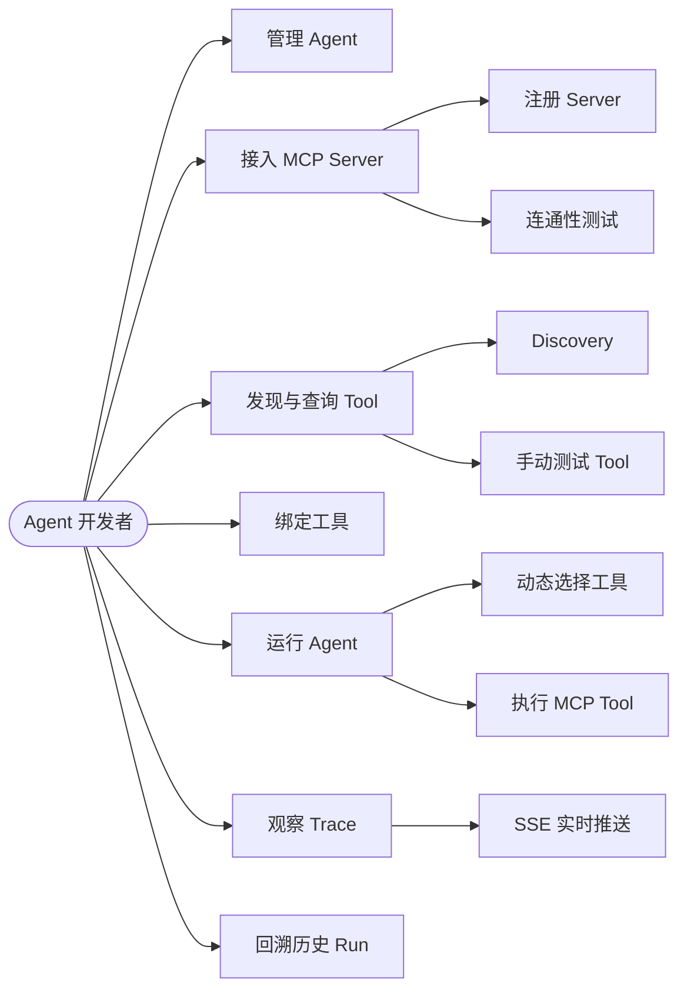
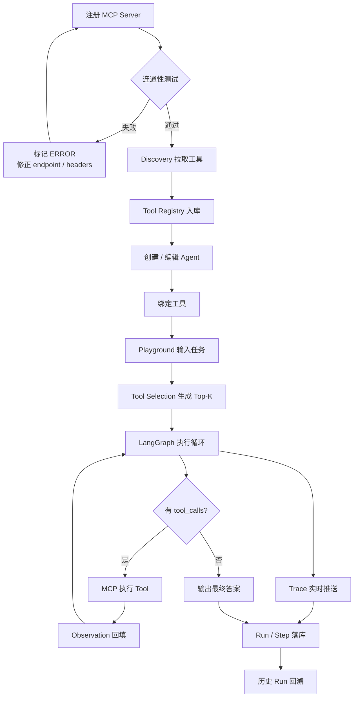
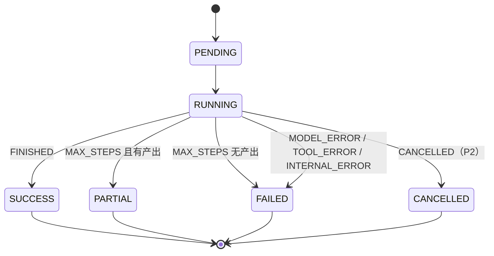

# AgentHub 需求分析文档

> **项目名称：AgentHub**
> **文档类型：需求分析（Requirements Analysis）**
> **版本：V1.0**
> **上游文档：无（本文档为需求基线）**
> **下游文档：AgentHub_系统设计文档.md（V1.0 MVP）、AgentHub_接口契约文档.md（Contract v1.3）、AgentHub_数据库设计文档.md（DB Design v1.2）**
> **日期：2026 年 9 月**

---

## 0. 文档说明

### 0.1 编写目的

本文档回答三个问题：**给谁做、做什么、做到什么程度算完成**。

系统设计文档描述"怎么实现"，接口契约描述"传什么字段"，数据库设计描述"怎么落库"。本文档不重复上述内容，只定义需求的**来源、边界、优先级与验收口径**，作为四个人并行开发时的需求基线。

### 0.2 四份文档的分工

| 文档 | 层次 | 回答的问题 | 事实来源优先级 |
|---|---|---|---|
| **本文档** | 需求 | 为谁做、做什么、为什么做、怎样算做完 | 范围与优先级以本文档为准 |
| 系统设计文档 | 架构 | 有哪些模块、如何交互 | 架构与模块边界 |
| 接口契约文档 | 协议 | 传什么字段、什么类型、什么枚举 | **跨模块接口以契约文档为准** |
| 数据库设计文档 | 存储 | 怎么落库、怎么约束、怎么查得快 | **字段类型、约束、索引、事务以 DB 文档为准** |

冲突裁决顺序：**需求范围（本文档）→ 接口契约 → 数据库设计 → 系统设计**。接口字段冲突一律以契约文档为准；需求是否属于本期，一律以本文档为准。

### 0.3 读者对象

| 读者 | 关注章节 |
|---|---|
| 角色 A（Agent Runtime） | §4.5、§4.6、§5、§8 |
| 角色 B（MCP Hub & Tool Selection） | §4.3、§4.4、§5、§8 |
| 角色 C（前端 & Trace UI） | §2、§4.7、§4.8、§5 |
| 角色 D（平台 & 数据） | §4.1、§4.7、§6、§7、§5 |
| 课程评审 / 答辩 | §1、§2、§9、§10、§11 |

### 0.4 术语与缩写

| 术语 | 含义 |
|---|---|
| Agent | 由模型、System Prompt、工具集合与步数上限构成的可持续执行体 |
| MCP | Model Context Protocol，Agent 与外部工具之间的标准协议 |
| MCP Server | 按 MCP 协议对外提供 Tool 的服务 |
| Tool / MCP Tool | MCP Server 暴露的单个可调用能力 |
| Tool Registry | 平台侧保存 Tool 元数据的注册表 |
| Discovery | 通过 MCP `tools/list` 拉取并同步 Tool 元数据的过程 |
| Tool Selection | 在 Run 开始前从已绑定工具中筛选 Top-K 候选的过程 |
| Trace | Agent 一次运行中产生的结构化事件序列 |
| Run | 一次"用户输入 → Agent 执行 → 最终结果"的完整记录 |
| Observation | Tool 执行结果回填给模型的消息 |
| SSE | Server-Sent Events，服务端单向实时推送 |
| Top-K | 动态工具选择保留的候选工具数量上限，V1 默认 5 |
| P0 / P1 / P2 | 需求优先级，定义见 §9.1 |

### 0.5 参考资料

- AgentHub 系统设计文档（架构、模块、状态机、扩展点）
- AgentHub 接口契约文档 v1.3（枚举、DTO、REST、SSE、内部接口）
- AgentHub 数据库设计文档 v1.2（表结构、约束、索引、事务）
- MCP 规范（`tools/list`、`tools/call`、Streamable HTTP 传输）
- 课程设计任务书（交付物、时间节点、评审标准）

---

## 1. 项目概述

### 1.1 项目背景

大模型具备工具调用能力之后，"Agent"从概念演示走向工程实践。但开发者在落地一个 Agent 时仍面临三类重复劳动：

1. **工具接入碎片化**：每个工具都要单独写适配代码，协议、鉴权、错误处理各不相同；
2. **执行过程黑盒**：模型为什么调用了这个工具、Observation 长什么样、第几步超限，缺少统一的观测手段；
3. **配置与运行耦合**：Prompt、模型、工具、步数上限散落在代码里，换一个场景就要改代码重发版。

MCP 协议的普及为第 1 点提供了标准答案，但"**如何把多个 MCP Server 组织成可配置、可运行、可观察的 Agent**"仍缺少轻量工具。AgentHub 由此提出。

### 1.2 项目定位

AgentHub 是一个**面向 Agent 开发者的轻量级 MCP Agent 构建、运行与调试平台**。

它不追求复刻 Dify、Flowise 等完整 AI 应用开发平台，只聚焦一个最小闭环：

> **创建 Agent → 接入 MCP 工具 → 运行 Agent → 观察执行过程 → 调试问题**

V1 只包含四个核心模块：

```text
Agent Builder + LangGraph Runtime + MCP Tool Hub + Execution Trace
```

### 1.3 目标用户与干系人

| 角色 | 类型 | 关注点 |
|---|---|---|
| Agent 开发者 | 系统直接用户 | 快速配置 Agent、接入工具、看清执行过程 |
| 课程评审 / 答辩老师 | 干系人 | 功能闭环是否完整、创新点是否成立、工程是否规范 |
| MCP Server 提供方 | 外部系统 | 协议兼容、调用可追溯、不被越权调用 |
| 小组成员 A/B/C/D | 干系人 | 需求边界清晰、接口可冻结、可并行开发 |

**V1 只有一个系统用户角色**：无登录、无权限体系、无多租户。所有人打开页面即是同一个工作空间（详见 §8.2）。

### 1.4 核心用户价值

| 价值 | 说明 | 对应需求 |
|---|---|---|
| 配置化构建 | Prompt、模型、工具、步数上限全部可在页面配置，无需改代码 | FR-AGENT |
| 工具即插即用 | 通过 MCP 标准协议接入，Discovery 自动同步工具清单 | FR-MCP |
| 上下文成本可控 | 工具多时只注入最相关的 Top-K，减少无关 Schema 占用 | FR-SELECT |
| 执行过程可见 | LLM、工具候选、Tool Call、Observation、最终答案实时可见 | FR-TRACE |
| 问题可定位 | 失败能归因到模型、工具还是平台内部，并保留历史现场 | FR-RUN、FR-HISTORY |

### 1.5 范围边界

#### 1.5.1 本期范围内（V1.0）

- Agent 配置管理（创建 / 查询 / 修改 / 软删除 / 工具绑定）
- LangGraph Agent Runtime（两节点循环、max_steps、停止策略）
- MCP Hub（Server 注册、连通性测试、Discovery、Tool Registry、Tool Router）
- 动态 Tool Selection（TF-IDF + Top-K）
- Execution Trace（9 类事件、持久化、SSE 实时推送）
- Agent Run History（Run 摘要、Step 时间线、按 Agent 查历史）
- PostgreSQL 持久化
- Vue 3 前端五个页面
- Docker Compose 一键部署

#### 1.5.2 本期明确不做

| 不做项 | 原因 |
|---|---|
| DAG Workflow / 可视化编排 | 超出最小闭环，V1 只做循环式 Agent |
| RAG 知识库 / 向量数据库 | 本项目不是 RAG 系统，工具检索用 TF-IDF 即可 |
| Multi-Agent / Supervisor / Handoff | 单 Agent 已足够验证核心链路 |
| 长期 Memory / 多轮对话 | `thread_id` 每次新建，不承载历史上下文 |
| Browser Agent / Coding Agent | 属高风险执行场景，与课程范围无关 |
| 登录、RBAC、多租户、计费 | V1 无身份体系，安全边界以"可信环境"为前提 |
| 插件市场 / Workflow Builder | 属平台生态能力，非 MVP 必需 |
| `stdio` 传输 | P2 再考虑，V1 只支持 Streamable HTTP |
| 自动清理历史数据 | 数据量小，且 Run/Step 是答辩核心资产 |
| 多实例部署 / 跨进程事件总线 | SSE 依赖进程内 `asyncio.Queue`，V1 单实例 |
| 加密存储 MCP `headers` | 威胁模型不成立，改用"不回传 + 不落 Trace + 不打日志"三重约束 |

### 1.6 项目成功标准

V1 完成时，以下 6 条同时成立即视为达成目标：

| 编号 | 成功标准 | 度量方式 |
|---|---|---|
| SC-01 | 主链路完整可演示：创建 Agent → 注册 MCP → Discovery → 绑定 → 运行 → Trace → 历史回溯 | §11.3 演示脚本一次走通 |
| SC-02 | 至少接入 2 个 MCP Server / 3 个 Tool，并完成一次包含 ≥ 2 次工具调用的任务 | 演示用例记录 |
| SC-03 | Trace 覆盖 LLM、工具候选、Tool Call、Tool Result、最终答案与总耗时 | SSE 事件与 Run Detail 对照 |
| SC-04 | 刷新页面后历史 Run / Step 仍可查看 | 手动验收 |
| SC-05 | 单次 Run 的失败能明确归因到 `stop_reason`，不出现"未知失败" | 故障注入用例 |
| SC-06 | `docker compose up` 在干净环境可一键启动全栈 | 部署验收 |

---

## 2. 用户与场景分析

### 2.1 用例概览



### 2.2 用户痛点与需求映射

| 编号 | 痛点 | 用户期望 | 对应需求 |
|---|---|---|---|
| P-01 | 工具接入要写适配代码 | 填一个 endpoint 就能用 | FR-MCP-01 ~ 05 |
| P-02 | 不知道模型为什么选错工具 | 看到候选工具与得分 | FR-SEL-03、FR-TRACE-01 |
| P-03 | 工具太多导致 Prompt 膨胀 | 只注入相关工具 | FR-SEL-01 ~ 04 |
| P-04 | 运行失败只有一句"出错了" | 知道是模型、工具还是平台的问题 | FR-RUN-04、FR-TRACE-07 |
| P-05 | 结果不可复现 | 能回看当时的输入、配置与每一步 | FR-HISTORY-01 ~ 03 |
| P-06 | Prompt / 工具改动要改代码 | 页面配置、即时生效 | FR-AGENT-01 ~ 06 |

### 2.3 核心用户故事

| 编号 | 用户故事 | 优先级 | 关联需求 |
|---|---|---|---|
| US-01 | 作为开发者，我要创建一个 Agent 并配置模型、System Prompt、最大步数，这样我不用改代码就能调整行为 | P0 | FR-AGENT-01 ~ 04 |
| US-02 | 作为开发者，我要注册一个 MCP Server 并测试连通性，这样我能确认地址和鉴权是否正确 | P0 | FR-MCP-01、FR-MCP-04 |
| US-03 | 作为开发者，我要一键 Discovery，把 Server 的工具同步进平台，这样我不必手动录入 Schema | P0 | FR-MCP-05、FR-MCP-06 |
| US-04 | 作为开发者，我要给 Agent 勾选可用工具，这样我能控制它的能力边界 | P0 | FR-AGENT-06 |
| US-05 | 作为开发者，我要在 Playground 输入任务并看到实时执行过程，这样我能判断 Agent 卡在哪一步 | P0 | FR-RUN-01、FR-TRACE-02 |
| US-06 | 作为开发者，我要看到本次注入的候选工具与得分，这样我能判断是工具选错了还是模型用错了 | P1 | FR-SEL-03 |
| US-07 | 作为开发者，我要在刷新页面后仍能查看历史 Run 与每一步明细，这样我能复盘问题 | P1 | FR-HISTORY-01 ~ 03 |
| US-08 | 作为开发者，当 Agent 绑定几十个工具时，我希望只注入最相关的 Top-K，这样能节省上下文并降低误选 | P1 | FR-SEL-01 ~ 04 |
| US-09 | 作为开发者，当 LLM 或 MCP 失败时，我要看到明确的失败原因，而不是笼统的"运行失败" | P0 | FR-RUN-04、FR-TRACE-07 |
| US-10 | 作为开发者，我要停用或删除 Agent 且不影响历史记录，这样我能安全地整理工作空间 | P1 | FR-AGENT-05、FR-AGENT-09 |

### 2.4 业务主流程



### 2.5 典型使用场景

#### 场景 1：首次跑通（Happy Path）

开发者注册课程自带的 Demo MCP Server，测试连通后 Discovery 出 3 个工具；创建 Research Agent，绑定其中 2 个；在 Playground 输入"查一下仓库最近 3 个 issue 并总结"，Trace 依次出现 `run_started` → `tool_candidates` → `llm_started/finished` → `tool_call_started/finished` → … → `run_finished`，最终答案展示在左侧。

**验收要点**：事件顺序正确、最终答案非空、总耗时展示。

#### 场景 2：工具过多

Agent 绑定了 20 个工具。用户输入与"issue"相关的任务，`tool_candidates` 只返回 5 个候选，且 `github.list_issues` 得分最高。

**验收要点**：候选数 ≤ top_k；得分降序；`strategy="tfidf"`。

#### 场景 3：故障定位

LLM API Key 失效，Run 在第一次模型调用后结束，`status=FAILED`、`stop_reason=MODEL_ERROR`，Trace 中 `llm_finished` 带 `error` 字段，页面显示可读错误。

**验收要点**：失败归因准确，页面不出现"未知错误"。

#### 场景 4：历史复盘

用户关闭页面后重新打开，进入 Run Detail，先拿到历史 Step，再决定是否订阅 SSE。历史事件完整、顺序不变、敏感字段已脱敏。

**验收要点**：刷新后 Step 数不减少；`payload` 中无明文密钥。

---

## 3. 业务需求

| 编号 | 业务需求 | 优先级 | 说明 |
|---|---|---|---|
| BR-01 | 平台必须支持以配置方式定义一个 Agent 的模型、Prompt、工具与步数上限 | P0 | 配置与运行分离是本项目存在的前提 |
| BR-02 | 平台必须通过 MCP 标准协议接入外部工具，且新增 Server 不需要改平台代码 | P0 | 工具接入的边际成本应接近零 |
| BR-03 | 平台必须能自动获取并维护工具元数据，包括名称、描述与入参 Schema | P0 | 手工维护 Schema 不可持续 |
| BR-04 | 平台必须完整记录并实时展示一次 Agent 运行的全过程 | P0 | "可观察"是本项目区别于脚本调用的核心价值 |
| BR-05 | 平台必须在工具数量较多时控制注入模型的工具规模 | P1 | 上下文预算与选错工具的双重约束 |
| BR-06 | 平台必须保证运行记录可持久化、可回溯、可复现 | P1 | 调试与答辩都需要历史现场 |
| BR-07 | 平台必须对高风险工具建立默认拒绝策略 | P0 | 演示环境不允许产生破坏性副作用 |
| BR-08 | 平台必须可在一台机器上以标准容器方式完整部署 | P0 | 课程验收环境不可控 |

---

## 4. 功能需求

### 4.1 需求清单总览

| 模块 | 需求数 | P0 | P1 | P2 | 主要责任角色 |
|---|---:|---:|---:|---:|---|
| Agent 配置管理（FR-AGENT） | 9 | 8 | 1 | 0 | D / C |
| MCP 接入与工具注册（FR-MCP） | 11 | 8 | 3 | 0 | B / D |
| 动态工具选择（FR-SEL） | 5 | 0 | 5 | 0 | B |
| Agent 运行（FR-RUN） | 11 | 8 | 2 | 1 | A / D |
| 执行追踪与实时推送（FR-TRACE） | 9 | 8 | 1 | 0 | A / D / C |
| 运行历史（FR-HISTORY） | 4 | 2 | 2 | 0 | D / C |
| 前端交互（FR-UI） | 8 | 6 | 1 | 1 | C |
| 通用能力（FR-COM） | 5 | 2 | 2 | 1 | D / C |
| **合计** | **62** | **42** | **17** | **3** | — |

### 4.2 FR-AGENT：Agent 配置管理

| 编号 | 需求 | 优先级 | 验收要点 |
|---|---|:--:|---|
| FR-AGENT-01 | 创建 Agent，可配置名称、描述、模型、System Prompt、`max_steps`、初始工具绑定 | P0 | 返回 201 与完整对象；`tool_ids` 非法时返回 `404 TOOL_NOT_FOUND` |
| FR-AGENT-02 | 分页查询 Agent 列表，支持 `enabled` 与 `keyword` 过滤 | P0 | 返回固定分页结构；默认按 `-created_at`；软删除不出现 |
| FR-AGENT-03 | 查询单个 Agent 详情 | P0 | 不存在返回 `404 NOT_FOUND` |
| FR-AGENT-04 | 部分更新 Agent 配置，未传字段保持不变 | P0 | 传 `null` 与不传等价；越界返回 `400` |
| FR-AGENT-05 | 软删除 Agent | P0 | 返回 204；列表不可见；历史 Run 仍可查 |
| FR-AGENT-06 | 全量覆盖更新 Agent 的工具绑定 | P0 | 语义为"提交最终态"，重复提交结果一致 |
| FR-AGENT-07 | 参数校验：`name` ≤ 64、`model` ≤ 128、`system_prompt` ≤ 8000、`max_steps` ∈ [1,20] | P0 | 全部在 DTO 层拦截，返回 `VALIDATION_ERROR` |
| FR-AGENT-08 | 已禁用 Agent 不允许发起 Run | P0 | 返回 `409 AGENT_DISABLED` |
| FR-AGENT-09 | Agent 删除后，其历史 Run 与 Step 保持可访问 | P1 | 直接通过 `run_id` 查询仍可返回 |

**业务规则**

1. `max_steps` 默认 8，上限 20，下限 1；DB、DTO、前端三处一致。
2. `model` 采用 `provider/model` 形式，用于后端路由到不同模型供应商。
3. Agent 名称允许重名，以 `id` 区分；不做唯一约束。
4. 只有 `max_steps` 可在 Run 级覆盖，其余配置只能通过 Agent 修改。

### 4.3 FR-MCP：MCP 接入与工具注册

| 编号 | 需求 | 优先级 | 验收要点 |
|---|---|:--:|---|
| FR-MCP-01 | 注册 MCP Server，填写名称、endpoint、transport、描述与鉴权 headers | P0 | 名称重复返回 `409 CONFLICT`；headers 永不回传前端 |
| FR-MCP-02 | 分页查询 Server 列表，支持按 `status` 过滤；查询 Server 详情 | P0 | 详情包含 `status`、`tool_count`、`last_discovered_at` |
| FR-MCP-03 | 更新 Server 配置；`name` 不可修改 | P0 | 请求中出现 `name` 时忽略；修改 endpoint/transport/headers 后状态重置为 `UNKNOWN` |
| FR-MCP-04 | 对 Server 做连通性测试 | P0 | 超时 10s；返回 `ok`、`latency_ms`、`server_info`；失败也返回 200，由 `ok` 判定 |
| FR-MCP-05 | 一键 Discovery，拉取并同步工具清单 | P0 | 返回 `added / updated / removed / total`；重复执行结果幂等 |
| FR-MCP-06 | 为工具生成全局唯一 `qualified_name`，格式为 `server_slug.remote_name` | P0 | 跨 Server 同名工具不冲突；`server_slug` 由名称按固定规则推导 |
| FR-MCP-07 | 按规则自动推断工具风险等级，并允许人工覆盖 | P1 | 只读类工具识别为 `READ_ONLY`；写类为 `WRITE`；Shell/支付类为 `HIGH_RISK` |
| FR-MCP-08 | 分页查询工具，支持按 `server_id`、`enabled`、`risk_level`、`keyword` 过滤 | P0 | 返回含 `input_schema` 与 `risk_level` |
| FR-MCP-09 | 手动测试单个工具 | P1 | 执行前做 Schema 校验；`WRITE` / `HIGH_RISK` 返回 `403 TOOL_RISK_DENIED` |
| FR-MCP-10 | Discovery 边界处理：超长名称跳过、非法 Schema 降级、`HIGH_RISK` 丢弃 | P1 | 单条异常不阻断同 Server 其他工具入库 |
| FR-MCP-11 | MCP Server 故障隔离 | P0 | 单个 Server 不可达时仅自身标记 `ERROR`，其他 Server 与平台功能不受影响 |

**业务规则**

1. **注册后 `name` 不可修改**：它派生出 `server_slug`，进而决定已有 `qualified_name`；
2. **Discovery 不物理删除工具**：本次未返回的工具置 `enabled=false`，保留历史绑定可解释性；
3. **`HIGH_RISK` 工具不入库**：在 Discovery 阶段直接丢弃，而不是入库后禁用；
4. **endpoint 安全校验**：`streamable_http` 必须是 `http/https`，默认禁止 `localhost`、`127.0.0.1`、链路本地地址与云元数据地址（可通过 `ALLOW_PRIVATE_MCP=true` 放开，用于课程本地环境）；
5. **Server 名称唯一**，是唯一一个带唯一约束的业务名称。

### 4.4 FR-SEL：动态工具选择

| 编号 | 需求 | 优先级 | 验收要点 |
|---|---|:--:|---|
| FR-SEL-01 | 每次 Run 开始前，从"该 Agent 已绑定且 enabled"的工具中筛选 Top-K | P1 | 默认 K=5；候选集不得包含未绑定或已禁用工具 |
| FR-SEL-02 | 使用 TF-IDF + 余弦相似度对工具与用户输入做相关性排序 | P1 | 索引文本由 `qualified_name + description + server_name` 构成 |
| FR-SEL-03 | 输出 `TOOL_CANDIDATES` 事件，包含名称、得分、策略与 K 值 | P1 | `names` 与 `scores` 一一对应且降序 |
| FR-SEL-04 | 降级策略：可用工具数 ≤ K 或查询为空时，注入全部可用工具 | P1 | 此时 `strategy="none"`，不影响 Run 正常执行 |
| FR-SEL-05 | 选择结果可解释 | P1 | 页面能展示"为何这些工具入选"的得分依据 |

**业务规则**

1. Tool Selection 发生在 Run 级，**不是**每次 LLM 调用都重新选择；
2. 选择范围严格限制在 Agent 已授权工具内，是一种**收敛**而非扩大；
3. 本需求是 P1 创新点，若进度紧张可降级为"全量注入 + `strategy=none`"，但接口与事件必须保留。

### 4.5 FR-RUN：Agent 运行

| 编号 | 需求 | 优先级 | 验收要点 |
|---|---|:--:|---|
| FR-RUN-01 | 创建并异步启动一次 Run，立即返回 `202` 与 `run_id` | P0 | 不等待执行完成；前端可立即订阅 SSE |
| FR-RUN-02 | 支持 Run 级覆盖 `max_steps`，并快照到 Run 记录 | P0 | `GET /api/runs/{id}` 可还原当时的上限 |
| FR-RUN-03 | 使用 LangGraph 两节点循环：`model_node` ↔ `tools_node` | P0 | 有 `tool_calls` 进工具节点，无则结束 |
| FR-RUN-04 | 实现 6 类停止原因：`FINISHED`、`MAX_STEPS`、`MODEL_ERROR`、`TOOL_ERROR`、`INTERNAL_ERROR`、`CANCELLED` | P0 | 每种原因都有可复现的用例 |
| FR-RUN-05 | 支持 `PARTIAL`：达到 `max_steps` 但已有部分产出时保留输出 | P1 | 结束事件为 `run_finished`，但 `stop_reason=MAX_STEPS` |
| FR-RUN-06 | Run 前校验：Agent 存在且启用、至少绑定 1 个可用工具 | P0 | 分别返回 `404`、`409 AGENT_DISABLED`、`422 NO_EXECUTABLE_TOOL` |
| FR-RUN-07 | 统计 `llm_calls`、`tool_calls`、`step_count`、`duration_ms` | P0 | Run 摘要中数值与 Trace 事件一致 |
| FR-RUN-08 | Tool 执行前完成权限校验与入参 Schema 校验 | P0 | 未绑定 → `TOOL_NOT_BOUND`；参数不符 → `TOOL_SCHEMA_INVALID` |
| FR-RUN-09 | Tool 结果回填为 Observation，模型继续推理直至输出最终答案 | P0 | 至少两次工具调用的用例可正常收敛 |
| FR-RUN-10 | 取消正在执行的 Run | P2 | V1 可返回 `501`，接口保留 |
| FR-RUN-11 | `thread_id` 每次 Run 新建，不复用、不承载上下文 | P1 | 两次 Run 之间模型看不到对方消息 |

**Run 状态机（需求视角）**



**关键规则**

1. **`run_finished` 不等于成功**：前端必须以 `status` 或 `stop_reason` 判断结果；
2. `MAX_STEPS` 的判定依据是 `step_count >= max_steps`，`step_count` 指图节点执行总次数；
3. 任一步失败后**不得**继续追加无意义的模型调用；
4. Run 结束后必须落库，即使 Trace 写入曾发生降级。

### 4.6 FR-TRACE：执行追踪与实时推送

| 编号 | 需求 | 优先级 | 验收要点 |
|---|---|:--:|---|
| FR-TRACE-01 | 将 LangGraph 与 MCP 的原始事件统一映射为 9 类平台事件 | P0 | 事件类型与契约 §2.7 完全一致 |
| FR-TRACE-02 | 通过 SSE 实时推送事件 | P0 | 帧含 `event` / `id` / `data`；15s 心跳 |
| FR-TRACE-03 | 同一 Run 内事件严格按 `step_no` 递增，组内按 `id` 递增 | P0 | 不重排、不去重 |
| FR-TRACE-04 | 支持断线重连补推 | P1 | 携带 `Last-Event-ID` 时从 `id >` 该值续传 |
| FR-TRACE-05 | 浏览器断开 SSE 不取消 Run | P0 | 断开后 Run 继续执行并持久化 |
| FR-TRACE-06 | 连接时若已有历史事件，先补推历史再推实时 | P0 | 刷新页面后时间线完整 |
| FR-TRACE-07 | 写入与推送前完成脱敏与截断 | P0 | 敏感键替换为 `***`；长文本截断至 2000 字符；payload > 64KB 裁剪 |
| FR-TRACE-08 | Trace 写入失败时降级 | P0 | 只记日志，不抛异常、不阻断 Runtime |
| FR-TRACE-09 | `step_no` 语义统一 | P0 | 0 为 Run 级事件；N≥1 为图执行步；同一 `step_no` 可有多条事件 |

**事件清单**

| 事件 | 含义 | 所属阶段 |
|---|---|---|
| `RUN_STARTED` | Run 开始 | Run 级 |
| `TOOL_CANDIDATES` | 动态选择结果 | Run 级 |
| `LLM_STARTED` | 开始模型调用 | 模型节点 |
| `LLM_FINISHED` | 模型调用结束（含 token 与错误） | 模型节点 |
| `TOOL_CALL_STARTED` | 开始执行工具 | 工具节点 |
| `TOOL_CALL_FINISHED` | 工具执行结束（含结果摘要与耗时） | 工具节点 |
| `STATE_UPDATED` | 步数 / 最终答案更新 | 运行中 |
| `RUN_FINISHED` | Run 结束（不一定成功） | Run 级 |
| `RUN_FAILED` | Run 异常结束 | Run 级 |

### 4.7 FR-HISTORY：运行历史

| 编号 | 需求 | 优先级 | 验收要点 |
|---|---|:--:|---|
| FR-HISTORY-01 | 查询单次 Run 摘要 | P0 | 状态、计数、耗时、错误信息齐全 |
| FR-HISTORY-02 | 分页查询 Run 的历史 Step，支持增量补齐 | P0 | 固定按 `step_no ASC, id ASC` 排序；`after_step_no` 生效 |
| FR-HISTORY-03 | 按 Agent 分页查询历史 Run，支持状态过滤 | P1 | 默认 `-created_at` |
| FR-HISTORY-04 | 历史数据全量保留，不自动清理 | P1 | 重启后数据仍在；无定时任务 |

**业务规则**

1. 历史查询走 REST，不依赖 SSE；
2. Run 详情打开顺序：先查状态 → 再查历史 Step → 若仍在运行再订阅 SSE；
3. 软删除 Agent 不级联删除 Run / Step。

### 4.8 FR-UI：前端交互

| 编号 | 需求 | 优先级 | 验收要点 |
|---|---|:--:|---|
| FR-UI-01 | Agent 列表页：卡片展示、搜索、筛选、创建入口 | P0 | 空态与加载态可用 |
| FR-UI-02 | Agent 编辑页：模型、Prompt、`max_steps`、工具多选 | P0 | 保存后立即生效；校验错误就地提示 |
| FR-UI-03 | MCP Center：Server 列表、注册、测试、Discovery、工具表格 | P0 | 状态与工具数实时刷新 |
| FR-UI-04 | Playground：左侧输入与最终答案，右侧执行时间线 | P0 | 运行中输入框禁用；事件按序追加 |
| FR-UI-05 | Run Detail：Step 时间线、工具参数、结果摘要、耗时 | P1 | 支持刷新恢复 |
| FR-UI-06 | Trace 渲染容错 | P0 | 按 `step_no` 分组、组内按 `id` 排序；未知枚举显示原值不崩溃 |
| FR-UI-07 | 统一错误提示 | P0 | 展示 `code` 与 `message`，不暴露堆栈 |
| FR-UI-08 | 不做可视化 DAG / 拖拽编排 | P2 | 页面中不出现相关入口 |

### 4.9 FR-COM：通用能力

| 编号 | 需求 | 优先级 | 验收要点 |
|---|---|:--:|---|
| FR-COM-01 | 统一分页请求与响应结构 | P0 | `items / total / page / page_size` |
| FR-COM-02 | 统一错误响应与错误码表 | P0 | 非 2xx 均含 `code / message / detail / request_id / timestamp` |
| FR-COM-03 | 明确接口幂等性 | P1 | GET/PUT/DELETE 幂等；创建 Run 不幂等 |
| FR-COM-04 | `request_id` 贯穿请求与日志 | P1 | 响应必回带；可据此检索日志 |
| FR-COM-05 | 写操作结构化日志 | P2 | 记录动作与资源 ID；不记录敏感字段 |

---

## 5. 非功能需求

### 5.1 性能需求

| 编号 | 指标 | 目标值 | 验收方式 |
|---|---|---|---|
| NFR-PERF-01 | 普通 CRUD 接口响应时间 | P95 ≤ 300ms（不含 Discovery / Test / Tool 执行） | 压测或日志统计 |
| NFR-PERF-02 | 创建 Run 的接口响应时间 | ≤ 1s（返回 `202`，不等待执行） | 接口计时 |
| NFR-PERF-03 | Trace 事件从产生到前端可见 | P95 ≤ 1s | 时间戳对比 |
| NFR-PERF-04 | 单 Run 支持的最大图执行步数 | 20（与 `max_steps` 上限一致） | 边界用例 |
| NFR-PERF-05 | 1000 条 Run 下的历史列表查询 | P95 ≤ 500ms | 造数后测量 |
| NFR-PERF-06 | SSE 连接数 | 单实例 ≥ 20 并发连接 | 并发脚本 |
| NFR-PERF-07 | 前端首屏可交互 | ≤ 3s（本地网络） | Lighthouse / 手动 |

### 5.2 可靠性需求

| 编号 | 需求 | 验收方式 |
|---|---|---|
| NFR-REL-01 | Trace 落库失败不得阻断 Agent 执行 | 注入 DB 写失败，Run 仍完成 |
| NFR-REL-02 | 单个 MCP Server 故障不得影响其他 Server 与平台功能 | 关闭一个 Server 后其余可正常 Discovery 与调用 |
| NFR-REL-03 | SSE 断开不得取消 Run | 断开连接后 Run 仍变为终态 |
| NFR-REL-04 | 外部调用必须有超时：LLM 60s、Discovery 10s、Tool Call 20~30s | 超时用例 |
| NFR-REL-05 | 进程重启后历史 Run / Step 可查 | 重启后查询验证 |
| NFR-REL-06 | Run 结束状态更新必须带前置状态条件，防止重复结束 | 并发结束/取消用例 |

### 5.3 安全需求

| 编号 | 需求 | 验收方式 |
|---|---|---|
| NFR-SEC-01 | API Key、`headers` 等敏感信息不得返回前端 | 检查所有响应体 |
| NFR-SEC-02 | 敏感信息不得写入 Trace、日志与错误消息 | 检查 `agent_step.payload` 与日志 |
| NFR-SEC-03 | MCP endpoint 必须做协议与地址校验，防 SSRF | 传入内网/元数据地址被拒 |
| NFR-SEC-04 | Tool 入参必须按 `input_schema` 校验后才可执行 | 非法参数返回 422 |
| NFR-SEC-05 | `WRITE` / `HIGH_RISK` 工具默认拒绝，V1 无放行开关 | 调用返回 403 |
| NFR-SEC-06 | Tool Result 与 Trace 文本必须截断，防止存储放大 | 超长结果被裁剪并标记 `truncated` |
| NFR-SEC-07 | 前端错误提示不得暴露堆栈、SQL、内部路径 | 故障注入后检查页面与响应 |

### 5.4 可用性与易用性需求

| 编号 | 需求 | 验收方式 |
|---|---|---|
| NFR-USE-01 | 新用户不阅读文档即可完成"创建 → 绑定 → 运行" | 找一名未参与开发的同学实测，10 分钟内完成 |
| NFR-USE-02 | 运行中的每一步都有明确的视觉状态（等待/执行中/成功/失败） | UI 走查 |
| NFR-USE-03 | 失败信息必须包含可执行建议（如检查 Key、检查 endpoint） | 用例走查 |
| NFR-USE-04 | 关键操作有二次确认（删除、覆盖绑定） | UI 走查 |

### 5.5 可维护性与可移植性需求

| 编号 | 需求 | 验收方式 |
|---|---|---|
| NFR-MAIN-01 | 跨模块接口在开发前冻结，变更需走契约流程 | 契约文档版本记录 |
| NFR-MAIN-02 | 分层清晰：API 不直接操作 ORM，Runtime 不感知 FastAPI | Code Review |
| NFR-MAIN-03 | 核心逻辑有单元测试：Selector、Router、StopPolicy、Schema 校验 | 测试报告 |
| NFR-MAIN-04 | 数据库变更必须通过迁移脚本，不允许手工 DDL | 检查迁移目录 |
| NFR-MAIN-05 | Python 3.12+ / PostgreSQL 16 / 现代浏览器（Chrome、Edge 最近两个大版本） | 环境验收 |
| NFR-MAIN-06 | 一条命令启动全栈 | `docker compose up` 验收 |

### 5.6 可观测性需求

| 编号 | 需求 | 验收方式 |
|---|---|---|
| NFR-OBS-01 | 每个请求有 `request_id`，错误响应必回带 | 接口检查 |
| NFR-OBS-02 | 写操作产生结构化日志，含动作、资源与结果 | 日志抽样 |
| NFR-OBS-03 | Run 的关键指标（步数、调用次数、耗时）可在摘要中直接读取 | 接口检查 |
| NFR-OBS-04 | 平台自身异常与业务失败可区分（`INTERNAL_ERROR` vs 其他 `stop_reason`） | 故障注入 |

---

## 6. 数据需求

### 6.1 核心数据对象

| 对象 | 说明 | 生命周期 |
|---|---|---|
| Agent | Agent 配置（模型、Prompt、步数上限、启用状态） | 软删除，记录保留 |
| MCP Server | 外部工具服务的注册信息 | 可禁用，可删除（级联工具与绑定） |
| MCP Tool | 工具元数据（名称、描述、Schema、风险等级） | 随 Discovery 更新，消失时禁用 |
| Agent-Tool 绑定 | Agent 与工具的多对多关系 | 全量覆盖更新 |
| Agent Run | 一次运行记录（输入、输出、状态、计数、耗时） | 全量保留 |
| Agent Step | Trace 事件（事件类型、节点、工具、payload） | 随 Run 级联删除 |

### 6.2 数据量估算（课程演示）

| 对象 | 量级 | 增长来源 |
|---|---:|---|
| Agent | 十级 | 手工创建 |
| MCP Server | 个位数 | 手工注册 |
| MCP Tool | 十级 | Discovery |
| Agent Run | 百~千级 | 每次运行 |
| Agent Step | 万级 | 每 Run 约 10~15 条 |

**结论**：无需分区、归档、只读副本与向量库；索引按访问路径精确建立即可。

### 6.3 数据质量要求

1. 所有时间统一存 UTC，展示层按 `Asia/Shanghai` 换算；
2. 枚举值以契约文档为准，DB 用 `varchar + CHECK` 约束；
3. 可查询的业务字段不得塞进 JSONB；
4. Run 必须记录 `max_steps` 快照，保证停止条件可复现；
5. `step_no` 不唯一，事件唯一性由自增 `id` 承担；
6. Tool Result 原始 `content` 不落库，仅保留摘要、长度与截断标记。

---

## 7. 接口需求

### 7.1 外部接口

| 接口 | 方向 | 要求 |
|---|---|---|
| LLM Provider | 出站 | 兼容 OpenAI Chat Completions 与 Tool Calling；支持 DeepSeek、Qwen、OpenAI 等；超时 60s |
| MCP Server（Streamable HTTP） | 出站 | 支持 `initialize`、`tools/list`、`tools/call`；连接与调用超时分别 10s / 20~30s |

### 7.2 内部接口

| 接口类型 | 消费方 → 提供方 | 要求 |
|---|---|---|
| REST API | 前端 C → 后端 D | 路径统一 `/api`；字段 `snake_case`；固定错误结构 |
| SSE | 前端 C → TraceService | 帧格式固定；`id` 单调递增；15s 心跳 |
| Python Protocol | A ↔ B ↔ D | `ToolSelector`、`McpToolGateway`、`AgentRunner`、`TraceSink` 签名冻结 |

### 7.3 接口质量要求

| 编号 | 要求 | 验收 |
|---|---|---|
| IR-01 | 所有接口返回资源本体，不做 `{code, data}` 包装 | 接口抽查 |
| IR-02 | 异步动作返回 `202`，同步创建返回 `201`，删除返回 `204` | 接口抽查 |
| IR-03 | 允许新增可选字段与枚举值；消费方必须容忍未知枚举 | Code Review |
| IR-04 | 契约文档是接口唯一事实来源，代码与文档不一致时以文档为准 | 契约测试 |
| IR-05 | 未在契约中定义的接口，任何一方不得私自调用 | Code Review |

---

## 8. 约束与假设

### 8.1 技术约束

| 约束 | 影响 |
|---|---|
| 使用 LangGraph，不自研图执行框架 | Runtime 只负责节点逻辑与事件映射 |
| 使用官方 MCP Python SDK | 协议细节由 SDK 封装，业务层只依赖适配器 |
| V1 不引入 Redis / 消息队列 / 向量数据库 | 动态选择用进程内 TF-IDF；事件推送用进程内队列 |
| SSE 依赖进程内 `asyncio.Queue` | **只能单 backend 实例部署** |
| 数据库固定 PostgreSQL 16 | JSONB 存 Schema 与 Trace payload |
| 前端固定 Vue 3 + TypeScript | 不做 SSR，不做可视化编排 |

### 8.2 业务与课程约束

| 约束 | 影响 |
|---|---|
| 四人小组，三周完成主体、第四周收尾 | 必须做优先级裁剪，P0 先行 |
| 无登录、无身份体系 | 不做审计、不做 RBAC、不做多租户 |
| 演示环境默认只接入可信 MCP Server | 安全策略以"默认拒绝写操作"为主 |
| 答辩现场不依赖外网可达性 | Demo MCP Server 随 compose 启动 |
| 课程评分包含创新点 | 动态 Tool Selection 与统一 Trace 是必须讲清的部分 |

### 8.3 假设

| 编号 | 假设 | 不成立时的影响 |
|---|---|---|
| A-01 | 所用 LLM 支持标准 Tool Calling | 需退化为 Prompt 解析，工作量显著增加 |
| A-02 | 演示用 MCP Server 遵循 MCP 规范并返回合法 JSON Schema | 需增加兼容层，否则工具不可用 |
| A-03 | 单用户操作，不存在并发编辑同一 Agent 的场景 | 需补乐观锁与冲突提示 |
| A-04 | 浏览器支持 `EventSource` | 需改用 fetch 流式解析 |
| A-05 | 部署环境可访问 LLM API | 需准备本地 mock 模型用于演示 |

### 8.4 外部依赖

- MCP Python SDK（版本需锁定，避免协议变更导致不可用）
- LangGraph / LangChain（版本需锁定）
- LLM Provider 的 API Key 与配额
- PostgreSQL 16 镜像、Node 运行时、Python 3.12+ 镜像

---

## 9. 需求优先级与迭代规划

### 9.1 优先级定义

| 级别 | 定义 | 处理策略 |
|---|---|---|
| P0 | 主链路必需 | 必须完成，缺失则不予验收 |
| P1 | 完整度与创新点 | 应当完成，进度紧张时可按模块整体裁剪 |
| P2 | 本期不实现 | 只保留接口或文档约定，不投入开发 |

### 9.2 迭代映射

| 阶段 | 目标 | 主要需求 |
|---|---|---|
| Week 1 | 跑通 `Agent → Tool → Observation → Final` | FR-AGENT、FR-MCP-01/04/05/06、FR-RUN-01/03/09、FR-COM-01/02 |
| Week 2 | 形成完整产品闭环 | FR-RUN-04/07、FR-TRACE-01/02/03/05/06、FR-HISTORY-01/02、FR-UI-01 ~ 04 |
| Week 3 | 创新点与质量 | FR-SEL-01 ~ 05、FR-MCP-07/09/10、FR-TRACE-04/07/08、FR-UI-05 |
| Week 4 | 收尾 | 缺陷修复、部署验收、文档与答辩材料 |

### 9.3 裁剪预案

若进度滞后，按以下顺序裁剪，**不得**裁剪 P0：

1. FR-SEL 整体降级为"全量注入 + `strategy=none`"（保留事件结构）；
2. FR-MCP-07 风险自动推断降级为固定 `LOW_RISK`；
3. FR-HISTORY-03 按 Agent 查历史降级为全局 Run 列表；
4. FR-UI-05 Run Detail 降级为在 Playground 内展开历史；
5. FR-RUN-05 `PARTIAL` 降级为 `FAILED`，但事件与字段保留。

---

## 10. 需求追踪矩阵

| 需求 | 优先级 | 设计文档 | 接口契约 | 数据库设计 | 验收用例 |
|---|:--:|---|---|---|---|
| FR-AGENT-01 ~ 07 | P0 | §5、§11.1 | §3.1、§4.1 | §3.1、§3.4 | §11.2 AC-01 ~ 05 |
| FR-AGENT-08 | P0 | §6.4 | §4.3.1 | §3.1 | AC-22 |
| FR-AGENT-09 | P1 | §10 | §4.1.5 | §8 | AC-06 |
| FR-MCP-01 ~ 06 | P0 | §8.1、§8.2 | §3.2、§4.2 | §3.2、§3.3 | AC-07 ~ 12 |
| FR-MCP-07 ~ 10 | P1 | §8.4 | §3.3、§4.2.6 | §3.3 | AC-13 ~ 16 |
| FR-MCP-11 | P0 | §8.1 | §4.2.5 | §3.2 | AC-09 |
| FR-SEL-01 ~ 05 | P1 | §7 | §6.1 | §3.3 | AC-17 ~ 20 |
| FR-RUN-01 ~ 09 | P0 | §6 | §3.4、§4.3 | §3.5 | AC-21 ~ 28 |
| FR-RUN-10 ~ 11 | P2 / P1 | §6.4、§6.5 | §4.3.6、§10 D4 | §3.5 | AC-29 |
| FR-TRACE-01 ~ 09 | P0 / P1 | §9 | §5、§7 | §3.6 | AC-30 ~ 36 |
| FR-HISTORY-01 ~ 04 | P0 / P1 | §10、§11.3 | §4.3 | §3.5、§3.6 | AC-37 ~ 39 |
| FR-UI-01 ~ 08 | P0 / P1 | §12 | §8 | — | AC-40 ~ 44 |
| FR-COM-01 ~ 05 | P0 / P1 | §11 | §1 | §7.6 | AC-45 ~ 47 |
| NFR-PERF-01 ~ 07 | — | §14.1 | — | §7.3 | 性能测试 |
| NFR-REL-01 ~ 06 | — | §14.1 | §6.3 | §7.4 | 故障注入 |
| NFR-SEC-01 ~ 07 | — | §14.2 | §7 | §5.3 | 安全走查 |

---

## 11. 验收标准

### 11.1 验收原则

1. **主链路优先**：P0 用例全部通过才算功能验收通过；
2. **可复现**：每个失败用例必须能通过固定步骤重现；
3. **可观察**：验收以页面表现与接口返回为准，不以"代码写了"为准；
4. **不掩盖**：Trace 降级、工具失败等场景必须显式呈现，不允许静默吞掉。

### 11.2 功能验收清单

| 编号 | 用例 | 预期结果 |
|---|---|---|
| AC-01 | 创建合法 Agent | 201，字段完整，`tool_ids` 正确 |
| AC-02 | 创建 Agent 时 `max_steps=0` | 400 `VALIDATION_ERROR` |
| AC-03 | 创建 Agent 时引用不存在的 Tool | 404 `TOOL_NOT_FOUND` |
| AC-04 | 部分更新 Agent 只传 `max_steps` | 其他字段不变 |
| AC-05 | 更新工具绑定为最终态 | 重复提交结果一致 |
| AC-06 | 软删除 Agent 后查历史 Run | 历史仍可访问 |
| AC-07 | 注册重名 MCP Server | 409 `CONFLICT` |
| AC-08 | 注册内网地址 endpoint | 400 `INVALID_ARGUMENT` |
| AC-09 | 对不可达 Server 测试连通性 | 200 + `ok=false`，状态 `ERROR` |
| AC-10 | Discovery 成功 | 返回新增/更新/移除计数，工具可查 |
| AC-11 | 重复 Discovery | 结果幂等，无重复工具 |
| AC-12 | 两个 Server 存在同名工具 | `qualified_name` 不冲突 |
| AC-13 | 工具名超 128 字符 | 跳过该工具，其他工具正常入库 |
| AC-14 | 工具 Schema 非法 | 以 `{}` 入库且 `enabled=false` |
| AC-15 | Discovery 遇到 `HIGH_RISK` 工具 | 不入库 |
| AC-16 | 手动调用 `WRITE` 工具 | 403 `TOOL_RISK_DENIED` |
| AC-17 | 绑定 20 个工具后运行 | 候选 ≤ 5，得分降序 |
| AC-18 | 绑定 3 个工具后运行 | 全部注入，`strategy="none"` |
| AC-19 | 候选工具与任务无关 | 不出现未绑定/禁用工具 |
| AC-20 | 候选为空 | Run 正常执行，不崩溃 |
| AC-21 | 创建 Run | 202，`status=RUNNING`，返回 `run_id` |
| AC-22 | 对禁用 Agent 发起 Run | 409 `AGENT_DISABLED` |
| AC-23 | Agent 无可用工具时发起 Run | 422 `NO_EXECUTABLE_TOOL` |
| AC-24 | 单工具任务 | 一次 Tool Call 后返回答案 |
| AC-25 | 双工具任务 | ≥ 2 次 Tool Call 后收敛 |
| AC-26 | `step_count` 达到 `max_steps` | `stop_reason=MAX_STEPS`，状态正确 |
| AC-27 | LLM Key 失效 | `stop_reason=MODEL_ERROR`，错误可读 |
| AC-28 | Tool 调用超时 | `stop_reason=TOOL_ERROR`，Trace 有错误 |
| AC-29 | 取消已结束 Run（P2） | 409 `RUN_NOT_RUNNING` |
| AC-30 | 完整 Run 的 SSE 事件 | 首事件 `run_started`，末事件为 `run_finished` / `run_failed` |
| AC-31 | 事件顺序 | 按 `step_no` 递增，组内按 `id` 递增 |
| AC-32 | 运行中断开 SSE | Run 继续并最终落库 |
| AC-33 | 重连携带 `Last-Event-ID` | 无重复、无丢失 |
| AC-34 | Run 结束后再订阅 SSE | 补推全部历史后关闭 |
| AC-35 | 检查 `payload` 敏感字段 | 均为 `***` |
| AC-36 | 构造超长 Tool Result | 截断至 2000 字符并标记 `truncated` |
| AC-37 | 查询 Run 摘要 | 计数与 Trace 一致 |
| AC-38 | 按 `after_step_no` 增量查询 | 只返回更大的步号 |
| AC-39 | 刷新页面后查看历史 | Step 数不减少，顺序不变 |
| AC-40 | Agent 列表搜索与筛选 | 结果正确，空态正常 |
| AC-41 | 编辑 Agent 后立即运行 | 新配置生效 |
| AC-42 | MCP Center 完成注册→测试→Discovery | 状态与工具数同步更新 |
| AC-43 | Playground 运行任务 | 左侧答案、右侧时间线同步出现 |
| AC-44 | 后端返回未知枚举值 | 前端显示原值，不白屏 |
| AC-45 | 分页参数越界 | 参数校验失败或按上限处理，行为一致 |
| AC-46 | 任意错误响应 | 含 `code`、`message`、`request_id`、`timestamp` |
| AC-47 | 数据库写 Trace 失败 | Run 仍完成，日志有记录 |

### 11.3 答辩演示脚本

1. 启动 `docker compose up`，打开平台；
2. 在 MCP Center 注册 Demo MCP Server → 测试连通 → Discovery；
3. 创建 Research Agent，配置 Prompt 与 `max_steps=8`，绑定 2 个工具；
4. 在 Playground 输入需要两次工具调用的任务；
5. 指出 Trace 中的候选工具、得分、Tool Call 参数、结果摘要与耗时；
6. 人为制造一次模型错误，展示失败归因；
7. 刷新页面，进入 Run Detail 回放历史；
8. 说明范围边界与后续扩展点。

---

## 12. 风险与对策

| 编号 | 风险 | 概率 | 影响 | 对策 |
|---|---|:--:|:--:|---|
| R-01 | MCP SDK 版本或协议变动 | 中 | 高 | 锁定版本；业务层只依赖 `McpClientAdapter` |
| R-02 | 不同 LLM 的 Tool Calling 行为不一致 | 高 | 中 | 统一 Provider 适配层；用 Mock ChatModel 做确定性测试 |
| R-03 | 四人并行导致接口对不齐 | 中 | 高 | 第一天冻结契约；前端用契约示例做 Mock |
| R-04 | 三周排期不足 | 中 | 高 | 严格执行 P0/P1/P2；按 §9.3 预案裁剪 |
| R-05 | 外网 MCP / LLM 不可达 | 中 | 高 | Demo MCP Server 随 compose 启动；准备 Mock 模型 |
| R-06 | Trace 数据量或长文本拖垮 DB | 低 | 中 | 截断 + 体积裁剪 + 独立短事务 + 写入降级 |
| R-07 | MCP 工具 Schema 质量差 | 中 | 中 | 入参校验 + 风险分级 + 手工测试入口 |
| R-08 | SSE 在单实例下成为瓶颈 | 低 | 低 | 明确单实例约束；扩展点写入文档 |
| R-09 | 动态选择效果不明显 | 中 | 低 | 保留 `strategy=none` 降级；答辩重点讲机制而非效果数字 |
| R-10 | 演示时误触高风险工具 | 低 | 高 | `WRITE` / `HIGH_RISK` 默认拒绝，无放行开关 |

---

## 13. 版本记录

| 版本 | 日期 | 变更 | 对齐基线 |
|---|---|---|---|
| 需求分析 V1.0 | 2026-09 | 首次成文：项目定位、用户与场景、8 项业务需求、62 项功能需求、非功能需求、数据与接口需求、约束假设、优先级与迭代、追踪矩阵、验收标准、风险 | 系统设计 V1.0 / Contract v1.3 / DB Design v1.2 |
